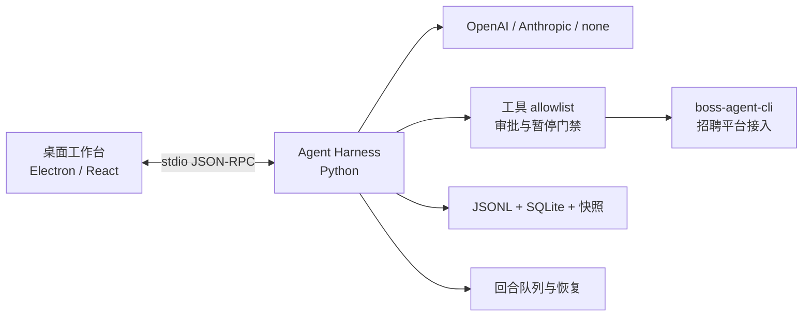

# BOSS Harness

<p align="center">
  <strong>面向招聘任务的 Agent Harness</strong><br>
  在桌面工作台里，把模型回合、招聘工具和可恢复会话连接成一条有边界的工作流。
</p>

<p align="center">
  <a href="https://github.com/can4hou6joeng4/boss-harness/actions/workflows/build.yml"></a>
  <a href="https://github.com/can4hou6joeng4/boss-harness/issues"></a>
  <a href="https://github.com/can4hou6joeng4/boss-harness/pulls"></a>
  <a href="https://github.com/can4hou6joeng4/boss-harness/stargazers"></a>
  <a href="LICENSE"></a>
</p>

> `boss-agent-cli` 负责招聘平台接入；BOSS Harness 负责模型适配、执行循环、权限边界、会话状态和桌面交互。内核参考 Pi 的 Agent Harness / Durable 设计思想，但按本项目的招聘安全契约独立实现。

**当前状态**：`main` 是开发分支，源码版本以[根包版本](package.json)为准；最新实际预发布为 [`v0.2.0-rc.15`](https://github.com/can4hou6joeng4/boss-harness/releases/tag/v0.2.0-rc.15)。桌面当前从源码构建，尚无独立安装包或签名发行。变化记录见 [CHANGELOG](CHANGELOG.md)，发布流程见 [RELEASING](RELEASING.md)，已发布资产见 [Releases](https://github.com/can4hou6joeng4/boss-harness/releases)。

## 项目定位

BOSS Harness 不是把招聘平台包成一个聊天接口，而是把「模型想做什么」与「实际允许做什么」分开：

- **执行与扩展**：固定 14 项工具 allowlist，能力发现不会增加权限；工具桥只经 stdio JSON-RPC 调用 `boss-agent-cli`。连续同名同参调用会收到内核提醒，但执行仍由模型决定。
- **平台动作**：写操作逐次审批，未知结果先核对；不自动翻页、不批量沟通、不绕过平台风控。
- **会话与证据**：append-only JSONL + SQLite 索引，冻结快照、摘要、分支和导出都保留来源与边界。
- **资源与隐私**：上下文、附件、工具结果、技能、导出和发布资产都有显式预算与静态守卫。

**适合**：希望把模型接入招聘工作流，同时需要本地状态、可恢复会话和明确审批边界的开发者与小团队。

**不适合**：批量投递、批量打招呼、自动绕过验证码 / 风控，或把未发布源码候选当作生产安装包。

## English overview

BOSS Harness is an agent harness for recruiting tasks: a desktop workbench that connects model turns, recruiting tools, and recoverable sessions into one bounded workflow. Recruiting actions always run through the separately installed `boss-agent-cli` subprocess; this repository owns the execution loop, context, sessions, approvals, and the Electron shell.

- **Architecture**: Electron + React + TypeScript desktop shell, a Python ≥ 3.10 kernel, and a stdio JSON-RPC `0.2.0` process boundary. The shell does not import kernel code.
- **Execution**: streaming turns, steering / follow-up queues, per-action approvals and stop, append-only JSONL history with SQLite indexing, context budgets and compaction tasks, durable restore, and branch-aware session state.
- **Safety boundary**: 14 allowlisted tools (13 read-only plus one greeting action that requires approval on every call); capability discovery never grants permissions, and the renderer never receives platform cookies.
- **Model routes**: OpenAI Responses (Codex or an explicit endpoint), Anthropic Messages, or `none`, sharing the same turn and tool contract.
- **Desktop**: a single `boss` preload bridge over host-validated IPC; the renderer reaches the main process only through `window.boss` (no `ipcRenderer` / Electron / Node imports, no HTML sinks, CSP limited to local sources with no remote origins); the workbench surfaces the persistent turn queue with retry / withdraw, full-input review, and atomic promotion of a queued follow-up into current-turn steering, workspace skill selection and management, and auto-compaction policy settings; platform login uses an isolated browser partition; session export is sanitized on write; an offline `--check` preflight is included.
- **Design notes**: the kernel follows Pi's agent-harness / durable design ideas but implements this project's recruiting safety contract independently. A read-only review log of external reference repositories is kept in [UPSTREAM.md](UPSTREAM.md); those projects are not upstreams and their links do not imply endorsement.
- **Status**: source candidates on `main` are not releases; [project status](docs/STATUS.md) lists implemented, pending and non-goal boundaries.

`main` is the development branch; use GitHub Releases for published versions. The desktop is built from source and has no standalone installer yet. Documentation: [README](README.md) · [user guide](docs/USER_GUIDE.md) · [desktop guide](docs/DESKTOP_GUIDE.md) · [technical reference](docs/TECHNICAL_REFERENCE.md).

## 先找到你要的入口

| 你的目标 | 从这里开始 |
| --- | --- |
| 在本机跑起来并完成第一次只读查询 | [快速开始](#快速开始) → [试跑一条任务](#试跑一条任务) |
| 了解桌面交互与故障提示 | [桌面交互指南](docs/DESKTOP_GUIDE.md) → [使用指南](docs/USER_GUIDE.md) |
| 配置 OpenAI、Anthropic 或无模型模式 | [模型与运行时配置](#模型与运行时配置) → [使用指南](docs/USER_GUIDE.md) |
| 评估查询范围、权限和隐私边界 | [安全边界](#安全边界) → [内核与业务契约参考](docs/TECHNICAL_REFERENCE.md) |
| 接入自定义工具或参与贡献 | [模块与扩展](#模块与扩展) → [贡献与验证](CONTRIBUTING.md) |

## 能力地图

| 你想解决的问题 | BOSS Harness 的做法 |
| --- | --- |
| 让模型帮我找职位 | 将自然语言转换为结构化条件，只查询明确的逻辑页，并保留来源和分页事实。 |
| 让任务持续推进 | 用串行工具批次、`steering`、`follow-up` 和持久队列管理消息进入回合的时机。 |
| 核对任务归属与恢复责任 | `task/read` 只读查询 turn、queue 或摘要任务的持久状态、当前执行 owner、恢复策略和已验证关系；不会恢复或重放任务。 |
| 避免招聘操作被重复执行 | 工具调用有稳定身份、逐次审批和结果未知边界；断连后先核对，不凭猜测重放。 |
| 让长会话可追溯 | 原始记录写入 append-only JSONL，SQLite 提供索引，冻结快照、摘要和分支都保留来源切点。 |
| 整理单条消息的后续上下文 | 已结束消息可替换或排除，原始记录保留；编辑读取与回执受约 1 MiB 预算约束，超限在写入前拒绝，详见[使用限制](docs/USER_GUIDE.md#消息的后续模型上下文)。 |
| 读取较大的文本附件 | `attachment/read` 默认整份返回；整份超过约 1 MiB 单页预算时返回明确的 `RESPONSE_TOO_LARGE` 与分段建议，改用 `cursor` / `limit` 可按段读回完整正文，摘要变化时拒绝混用版本。 |
| 核对模型用量 | 会话用量面板按回合、摘要任务与合计展示已持久的 provider 上报，支持复制 CSV；来源字段有界校验，未上报与不计入请求分开显示。 |
| 恢复长会话 | 普通读取与冻结快照按响应预算分页，游标绑定实际返回条目；索引修复按会话隔离，损坏会话不会吞掉后续页的分页边界。 |
| 在不同模型线路间切换 | OpenAI Responses、Anthropic Messages 和 `none` 共享同一套回合与工具契约。 |
| 在桌面里观察过程 | Electron / React 工作台通过双向 stdio JSON-RPC 连接 Python 内核，显示回合、工具、队列和上下文状态；队列项支持重试 / 撤回与完整输入核对，技能选择器、工作区技能管理与自动压缩策略设置也在工作台内完成。 |
| 管理不再需要的会话 | 通过侧栏菜单归档或恢复，在标题栏或侧栏永久删除聊天；删除前列出将一并清除的本机草稿、附件与反馈，确认移除后不会被较早的列表刷新重新放回，运行中或排队时内核拒绝删除。 |

当前内核提供 14 个 allowlist 工具：13 个只读工具，以及一个需要逐次审批的招聘者打招呼工具。能力发现不会自动增加工具权限；模型与普通 renderer 不接收平台 Cookie。

## 快速开始

前置条件：Node.js 24+、Python 3.10+（读取 Codex TOML 配置需要 3.11+，开发建议 3.12）、`uv` 以及另行安装的 `boss-agent-cli`。招聘平台登录与可执行文件路径配置见[上游 CLI 设置](docs/USER_GUIDE.md#上游-cli-设置)。

```sh
uv venv --python 3.12 .venv
uv pip install --python .venv/bin/python -e ./harness
npm ci
npx install-electron --no
BOSS_HARNESS_PROVIDER=none npm run dev
```

`BOSS_HARNESS_PROVIDER=none` 只禁用模型，不禁用招聘 CLI。Electron 需要从源码启动；`npm run build` 只生成桌面源码产物，不是独立安装包。首次运行建议使用临时工作区与只读工具，不要在此阶段输入真实凭据。

## 试跑一条任务

桌面启动并完成上游 CLI 配置后，可以按下面的顺序从只读入口开始：

1. 确保 `boss-agent-cli` 已安装，并按[上游 CLI 设置](docs/USER_GUIDE.md#上游-cli-设置)确认本项目能找到其可执行文件。
2. 输入 `/tools`，查看上游当前提供的能力目录；它不是本地授权清单，实际可调用范围仍受 Harness allowlist 限制。
3. 输入 `/search Python`，确认上游 CLI 和工作区连接正常。
4. 配置模型后输入：`上海 Python，20–50K，3–5 年，本科，先看第一页`。
5. 回合运行中发送新消息，选择转向当前回合，或将它排到当前回合结束后的队列。
6. 按 `⌘⇧K` 打开「运行状态」，核对内核线路、并发与保留回合、待审批调用、工具与模型目录。更多界面行为见[桌面交互指南](docs/DESKTOP_GUIDE.md)。

桌面新建的会话固定使用只读工具策略：内核向模型提供 13 个只读工具（含能力发现）和 1 个只读内核结果分段读取工具，`boss_hr_greet` 不在该会话的工具清单中，也不会出现写操作审批卡；输入区「执行权限」菜单只展示这一固定策略，当前版本不提供切换入口。逐次审批只出现在以审批策略创建的会话中（`thread/start` 的 `toolPolicy: "approval"`，也是该参数缺省时的取值）：这类会话由其他客户端创建后，桌面会同样列出、读取并在聊天中展示审批卡，从它创建的分支沿用同一策略。

<details>
<summary>展开：这条搜索请求经过了什么</summary>

```text
自然语言条件
    ↓
模型生成结构化 boss_search 参数
    ↓
Harness 校验条件、页码和工具权限
    ↓
boss-agent-cli 查询指定逻辑页
    ↓
桌面展示结果、来源与分页事实
    ↓
用户决定是否查看下一页或继续追问
```

系统不会自动翻页、放宽条件或补取职位详情。下一页需要保留原条件并明确提交新的页码。
</details>

## 工作方式



| 组件 | 负责什么 | 交互结果 |
| --- | --- | --- |
| Electron / React 工作台 | 输入、消息、工具详情、队列、设置和上下文面板 | 用户能看到任务处于哪个回合、是否排队以及是否需要处理暂停。 |
| Python Agent Harness | 模型流、工具编排、审批、超时、持久化和恢复 | 一次回合的事实按顺序写入，可在重启后继续读取。 |
| `boss-agent-cli` | 招聘平台的登录、搜索、沟通列表和平台状态 | Harness 只派发已声明的业务契约，不替上游猜测分页或认证事实。 |
| JSONL + SQLite | 正文、事件、索引和快照 | 原始记录保留，索引可重建，冷读和恢复有明确预算。 |

完整交互清单见 [桌面交互指南](docs/DESKTOP_GUIDE.md)，请求预算与恢复契约见[内核与业务契约参考](docs/TECHNICAL_REFERENCE.md)。

## 安全边界

- 读取职位或沟通列表不会自动回复、投递、导出简历或翻页；招聘者打招呼需要逐次审批。桌面新建的会话为只读策略，不包含该工具（见上文「试跑一条任务」）。
- 超时、断连或持久化异常可能使外部写操作处于结果未知状态；内核会暂停并要求先核对，不自动重放。
- 模型与普通 renderer 不接收平台 Cookie；业务 CLI 的认证、浏览器来源、缓存和网络重试仍由其自身契约决定。
- `none` 只表示不调用模型，不表示不调用招聘 CLI，也不代表不会访问平台。
- 代码交付授权不等于招聘平台操作授权；对外沟通、投递和批量操作需要用户明确授权。

发现可能影响状态目录保护、JSON-RPC 边界、工具审批或导出脱敏的问题时，请先通过非公开渠道联系维护者，不要在公开 Issue 中附带可利用细节、凭据或真实招聘记录；报告方式与负责范围见[安全政策](SECURITY.md)。

首次运行建议使用临时工作区和只读工具。不要把凭据、Cookie 或真实招聘记录放入仓库、Issue、PR 或公开日志。

## 模型与运行时配置

桌面默认使用 OpenAI Responses，通过 `BOSS_HARNESS_PROVIDER` 可选择 `openai`、`anthropic` 或 `none`。

| 场景 | 配置入口 |
| --- | --- |
| OpenAI Responses | `BOSS_HARNESS_OPENAI_BASE_URL`、`BOSS_HARNESS_OPENAI_API_KEY`；模型由命令行 `--model`、`BOSS_HARNESS_MODEL`、`BOSS_HARNESS_OPENAI_MODEL` 或 Codex profile 提供。 |
| 本地 Codex profile | 显式 OpenAI 配置缺项时，依次读取 `BOSS_HARNESS_CODEX_CONFIG`、`CODEX_HOME/config.toml`、`~/.codex/config.toml`；provider 凭据支持 `experimental_bearer_token` 或 `env_key` 指定的环境变量。 |
| Anthropic Messages | 使用 `ANTHROPIC_*` 环境变量；`BOSS_HARNESS_ANTHROPIC_MODEL` 可指定默认模型。 |
| 单次模型传输 | 默认总时限 600 秒；`BOSS_HARNESS_MODEL_REQUEST_TIMEOUT_SECONDS` 可设为 1–3600 秒。 |
| 模型输出与请求次数 | `BOSS_HARNESS_MAX_TOKENS` 设置输出上限（默认 64000）；`BOSS_HARNESS_MAX_MODEL_REQUESTS` 设置单回合模型请求上限（默认 6，范围 1–64）。 |
| 模型自动重试 | 首个输出前的瞬时失败默认最多尝试 3 次、退避基数 500 毫秒；`BOSS_HARNESS_RETRY_ATTEMPTS`（1–10）与 `BOSS_HARNESS_RETRY_BASE_MS` 可调整。 |
| 审批等待期限 | 默认 300 秒；`BOSS_HARNESS_APPROVAL_TIMEOUT` 可设为正数秒。 |
| 桌面使用的解释器 | `BOSS_HARNESS_PYTHON`；未设置时使用仓库根目录的 `.venv/bin/python`，不存在则用 `python3`。 |
| 招聘 CLI 可执行文件 | 按 `BOSS_CLI_BIN`、并排的 `boss-agent-cli/.venv/bin/boss`、PATH 顺序查找。 |
| 两类本地状态 | `BOSS_CLI_DATA_DIR` 管理上游登录/平台状态；`BOSS_HARNESS_DIR` 管理本项目会话（旧 `BOSS_CLI_HARNESS_DIR` 仍兼容）。 |
| steering 投递 | `BOSS_HARNESS_STEERING_MODE` 为 `all`（默认，每个投递点注入全部排队 steering）或 `one-at-a-time`（每次只注入最早一条）。 |
| 持久附件存储 | 默认最多 512 MiB、4096 个对象；`BOSS_HARNESS_MAX_ATTACHMENT_STORAGE_BYTES` 和 `BOSS_HARNESS_MAX_ATTACHMENT_STORAGE_OBJECTS` 可分别设置正整数上限，实际生效值可由 `config/read` 查询。 |

可运行 `.venv/bin/boss-harness --check` 做本地配置预检，完整优先级、无效取值行为与故障排查见[本地配置自检](docs/USER_GUIDE.md#本地配置自检)和[桌面启动失败时的自检](docs/USER_GUIDE.md#桌面启动失败时的自检)。不要把 API key 或其他凭据写入仓库、配置样例或日志。

## 模块与扩展

内嵌 Python 应用可以通过 `ToolDefinition`、`ToolBundle` 和 `ApplicationService` 组合工具，或注入生命周期 hook。自定义工具仍须显式声明 schema、handler 和审批属性；任何外部或持久副作用都必须进入审批边界。默认招聘 bundle、平台登录能力和工具说明不会因为能力发现自动扩展。

需要评估请求预算、恢复、摘要、冷读、回合所有权或 JSON-RPC 契约时，请直接阅读[内核与业务契约参考](docs/TECHNICAL_REFERENCE.md)。独立摘要线路生成的内容，在自动压缩或溢出恢复提交前仍按当前业务模型的完整预算核对；摘要与当前输入容纳不下时暂停，不保存不适用的新检查点。

## 开发与验证

```sh
npm ci
npx install-electron --no
npm run typecheck
npm run build
uv venv --python 3.12 .venv
uv pip install --python .venv/bin/python build packaging
.venv/bin/python -m build ./harness --outdir dist/python
git diff --check
```

以上命令用于开发检查，允许使用工作树中的未提交改动；发布构建必须按 [RELEASING.md](RELEASING.md) 从指定提交的 `git archive` 隔离目录执行，避免未跟踪文件进入资产。

CI 在安装依赖前运行 `scripts/check_*.py`，覆盖以下不变量：

- **版本与发布元数据**：npm 根包 / 工作区 / 锁文件、Python 内核版本、变更记录首条与版本链递减、日期非递增、使用指南版本行、许可证元数据（根包与全部工作区均为 MIT、`LICENSE` 为 MIT 正文）、包元数据（仓库 / issues / Node 版本、工作区保持私有且有描述、Python readme / 入口 / wheel 路径）。
- **协议与传输**：内核注册方法与 `ClientMethods` 双向一致、协议常量（含宿主通知）、握手能力、内核 `MAX_FRAME_BYTES` 与 app-client 默认帧 / 队列上限（帧上限双端相等、队列不小于帧）、桌面渲染层方法白名单。
- **内核工具与本地资源**：14 个工具（13 个只读、仅 `boss_hr_greet` 需批准）、schema 边界完整、写工具集合三处一致、bundle 沿用审批标记、工具子进程显式 `shell=False` 且禁用 shell 调用；会话导出默认脱敏与请求边界（3 种格式、默认不导出工具明细、字节上限有序且低于 1 MiB 并与主进程上限一致、脱敏管线顺序与标记、工具参数 / 结果投影边界、不写盘）；状态目录 / 文件私有权限（0o700 / 0o600、`O_NOFOLLOW`、拒绝外部所有者、状态模块不直接写盘）；工作区技能加载（不跟随符号链接、有界读取、`scandir` 候选窗口与列表投影截断）；附件读取分页与存储配额（默认 16,384 / 最大 32,768 码点、单页预算、存储配额环境变量）；工具结果分页与引用边界（内联 64 KiB / 单页 1 MiB、默认 16,384 / 最大 32,768 码点、模型 8,192、摘要与游标归属、`STALE_RESULT` 恢复信息）；工具参数受限 schema（关键字 / 类型白名单、字节 / 节点 / 深度上限、注册表只读投影）；`queue/steer` 原子转换与状态机边界（持久 `_save`、active turn / `expectedTurnId`、技能 / 压缩覆盖拒绝、协议与桌面白名单 / 按钮一致）；重复调用提醒边界（阈值、规范化摘要、纯内存状态、工具结果后注入与 steering 重置）；浏览器来源覆盖边界（环境变量白名单与规范化、`--browser-source` 构造、启动自检与连接报告）；发布资产清单身份 / 摘要 / 工作流校验守卫。
- **桌面与 IPC 安全**：webPreferences 安全配置；主窗口权限白名单与判定函数；受信渲染来源 / 官方登录地址判定；两处视图的权限处理器语义与导航 / 卸载拦截；登录会话隔离；preload 桥接暴露面、暴露全局与导入来源、共享 `BossBridge` 类型；IPC 通道双引号字符串字面量与受信发送方入口校验；会话导出处理器不变量；主进程 / preload / 渲染层导入方向与 IPC 角色符号（主进程不得出现 `ipcRenderer`、preload 不得出现 `ipcMain`）；preload 不得读取 `process.env` / `process.argv` / `process.cwd` 或调用 `process.exit`；主进程仅 `startupCheck.ts`、app-client 仅 `index.ts` 以 `shell: false` 启动子进程；`node:child_process` 仅允许具名导入 `spawn` 与类型（禁止 `exec` / `execFile` / `execSync` / `execFileSync` / `spawnSync` / `fork`）；主进程禁止 `executeJavaScript` / `debugger`；渲染层禁止 `ipcRenderer` / `electron` / `node:*` / `require(`；入口 CSP、模块脚本、嵌入与远程资源限制；渲染层不得写入 HTML 或执行动态代码；会话恢复分页预算与内容引用校验（编码 / 哈希 / 标识 / 字符与字节关系 / 16 MiB 上限）；外部链接协议白名单双端一致、两侧判定函数保留与 `shell.openExternal` 唯一调用。
- **工作流 / 搜索 / 文档**：CI 顶层只读权限、禁用 `pull_request_target` / `workflow_run`、作业正整数 `timeout-minutes`、checkout 凭据设置、action 引用固定主版本、依赖审计命令保留与检查脚本接入完整性；双端搜索归一化在全部 Unicode 码点上对照，并在 Python 3.10–3.14 上分别运行与编译内核源码；根目录、`docs/`、`harness/` 与 `.github/` 下 Markdown 的相对链接、页内锚点、docs 索引与覆盖完整性。

本地可用同一入口逐项执行：

```sh
.venv/bin/python scripts/check_versions.py
.venv/bin/python scripts/check_protocol.py
.venv/bin/python scripts/check_desktop_security.py
.venv/bin/python scripts/check_workflows.py
.venv/bin/python scripts/check_harness_tools.py
.venv/bin/python scripts/check_export_privacy.py
.venv/bin/python scripts/check_private_files.py
.venv/bin/python scripts/check_skills.py
.venv/bin/python scripts/check_attachments.py
.venv/bin/python scripts/check_tool_results.py
.venv/bin/python scripts/check_tool_schema.py
.venv/bin/python scripts/check_queue_steer.py
.venv/bin/python scripts/check_loop_guard.py
.venv/bin/python scripts/check_browser_source.py
.venv/bin/python scripts/check_release_assets.py
.venv/bin/python scripts/check_search_unicode.py
.venv/bin/python scripts/check_docs_links.py
```

操作步骤见[发布约定](RELEASING.md#版本与文档一起准备)。

CI 随后执行 npm 依赖审计、TypeScript 检查、Electron 源码构建及 Python wheel / sdist 构建。两个 Python 包分别隔离安装，核对安装版本与命令显示版本后运行 `boss-harness --check --provider none`。`scripts/release_assets.py` 生成构建清单和 SHA-256 摘要，随 `python-dist` 工作流产物上传。真实模型、招聘平台、桌面 UI 和已签名安装包需要分别验收。提交与 PR 流程见[贡献与验证](CONTRIBUTING.md)。

## 项目导航

- [文档索引](docs/README.md)：使用、桌面与内核文档的职责和入口。
- [使用指南](docs/USER_GUIDE.md)：模型配置、请求期限、职位搜索、沟通列表、技能、队列和上游 CLI 设置。
- [桌面交互指南](docs/DESKTOP_GUIDE.md)：搜索、审批、通知、会话查找、队列、长会话、界面偏好与导出行为。
- [内核与业务契约参考](docs/TECHNICAL_REFERENCE.md)：请求边界、失败恢复、上下文预算、资源上限和模块接口。
- [项目状态与待验收范围](docs/STATUS.md)：源码候选与实际发布的区别、已具备能力、待完成事项与非目标。
- [贡献与验证](CONTRIBUTING.md)：开发约定、提交格式、PR 与文档同步。
- [支持与问题分流](SUPPORT.md)：文档、缺陷、功能建议与安全报告的合适入口。
- [行为准则](CODE_OF_CONDUCT.md)：社区参与的基本预期与处理方式。
- [发布约定](RELEASING.md)：候选版本节奏、版本一致性、发布验证与对外介绍。
- [安全政策](SECURITY.md)：安全报告渠道、负责范围与披露原则。
- [GitHub Releases](https://github.com/can4hou6joeng4/boss-harness/releases)：已发布 tag、说明与实际可下载资产。
- [上游吸收记录](UPSTREAM.md)：Pi 等参考项目的来源、取舍和适配差异。
- [版本变化](CHANGELOG.md)：候选版本的功能、修复和验证范围。
- [Issues](https://github.com/can4hou6joeng4/boss-harness/issues) · [Pull requests](https://github.com/can4hou6joeng4/boss-harness/pulls)

## License

本项目采用 [MIT License](LICENSE)；Python wheel / sdist 随附相同许可文本，第三方依赖遵循各自许可证。

欢迎通过 [Issues](https://github.com/can4hou6joeng4/boss-harness/issues) 反馈可复现的问题、使用场景或集成建议。向其他社区介绍本项目时，请遵守[发布约定中的对外介绍规则](RELEASING.md#对外介绍)，只写可验证的当前版本、来源与安装范围；参考项目的链接不代表其维护者背书。
