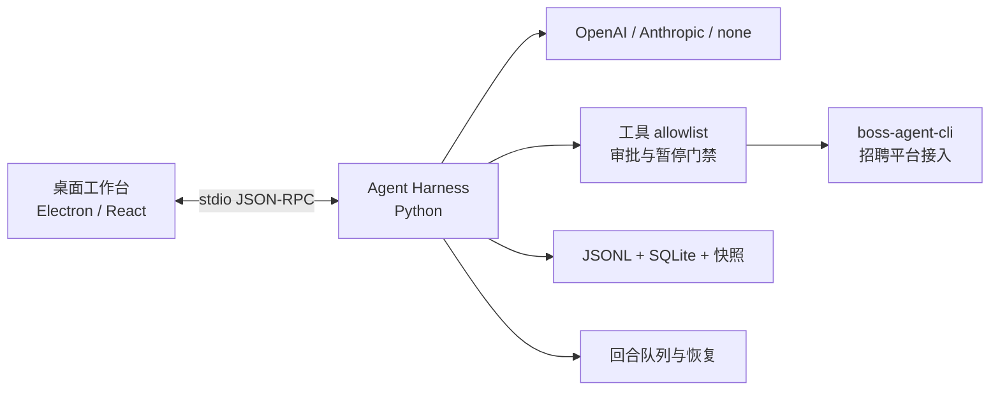

# BOSS Harness

<p align="center">
  <strong>面向招聘任务的 Agent Harness</strong><br>
  在桌面工作台里，把模型回合、招聘工具和可恢复会话连接成一条有边界的工作流。
</p>

<p align="center">
  <a href="https://github.com/can4hou6joeng4/boss-harness/actions/workflows/build.yml"></a>
  <a href="https://github.com/can4hou6joeng4/boss-harness/issues"></a>
  <a href="https://github.com/can4hou6joeng4/boss-harness/pulls"></a>
  <a href="https://github.com/can4hou6joeng4/boss-harness/stargazers"></a>
</p>

> `boss-agent-cli` 负责招聘平台接入；BOSS Harness 负责模型适配、执行循环、权限边界、会话状态和桌面交互。内核参考 Pi 的 Agent Harness / Durable 设计思想，但按本项目的招聘安全契约独立实现。

## English overview

BOSS Harness is an agent harness for recruiting tasks: a desktop workbench that connects model turns, recruiting tools, and recoverable sessions into one bounded workflow. Recruiting actions always run through the separately installed `boss-agent-cli` subprocess; this repository owns the execution loop, context, sessions, approvals, and the Electron shell.

- **Architecture**: Electron + React + TypeScript desktop shell, a Python ≥ 3.10 kernel, and a stdio JSON-RPC `0.2.0` process boundary. The shell does not import kernel code.
- **Execution**: streaming turns, steering / follow-up queues, per-action approvals and stop, append-only JSONL history with SQLite indexing, context budgets and compaction tasks, durable restore, and branch-aware session state.
- **Safety boundary**: 14 allowlisted tools (13 read-only plus one greeting action that requires approval on every call); capability discovery never grants permissions, and the renderer never receives platform cookies.
- **Model routes**: OpenAI Responses (Codex or an explicit endpoint), Anthropic Messages, or `none`, sharing the same turn and tool contract.
- **Desktop**: host-validated IPC, an isolated browser partition for platform login, sanitized session export, and an offline `--check` preflight.
- **Design notes**: the kernel follows Pi's agent-harness / durable design ideas but implements this project's recruiting safety contract independently. A read-only review log of external reference repositories is kept in [UPSTREAM.md](UPSTREAM.md); those projects are not upstreams and their links do not imply endorsement.

**Status**: `0.2.0-rc.56` is a source candidate (protocol `0.2.0`); the latest actual release is [`v0.2.0-rc.15`](https://github.com/can4hou6joeng4/boss-harness/releases/tag/v0.2.0-rc.15). The desktop is currently built from source — there is no standalone installer or signed distribution yet. Chinese documentation: [README](README.md) · [user guide](docs/USER_GUIDE.md) · [technical reference](docs/TECHNICAL_REFERENCE.md).

## 版本与交付状态

| 交付项 | 当前范围 |
| --- | --- |
| 源码候选版本 | `0.2.0-rc.56`，Python 内核为 `0.2.0rc56`；stdio JSON-RPC 协议为 `0.2.0`。 |
| 候选序号规则 | 候选序号不设位数上限：`0.2.0-rc.101`（npm）与 `0.2.0rc101`（Python）同样有效，跨过两位后继续按同一规则递增；发布脚本与桌面都把版本当作不透明字符串处理。 |
| 已发布版本 | 最新候选预发布为 [`v0.2.0-rc.15`](https://github.com/can4hou6joeng4/boss-harness/releases/tag/v0.2.0-rc.15)（2026-11-14 发布，UTC 为 2026-11-13T18:35:01Z）。tag 固定到源码提交 `560c86e2593592f86c61bdeddf0be099ec9d1272`。 |
| 本机运行 | 从源码启动 Electron 桌面端，使用本机 Python 内核与另行安装的 `boss-agent-cli`。 |
| 发布资产 | Python 内核 wheel / sdist、`build-info.json` 与 `SHA256SUMS.txt`；Electron main / preload / renderer 需从源码构建，当前没有独立桌面安装包或签名发行流程。 |
| 源码许可 | 本项目采用 [MIT License](LICENSE)；Python wheel / sdist 随附相同许可文本，第三方依赖遵循各自许可证。 |

更新内容见 [CHANGELOG](CHANGELOG.md)，版本准备、验证范围与发布步骤见 [发布约定](RELEASING.md)。源码版本、Release 与安装包分别核对，避免把一次源码构建当成完整桌面发行。

## 先找到你要的入口

| 你的目标 | 从这里开始 |
| --- | --- |
| 在本机跑起来并看一眼交互 | [开发与验证](#开发与验证) → [试跑一条任务](#试跑一条任务) |
| 了解搜索、队列、摘要和技能如何协作 | [工作方式](#工作方式) → [交互路径](#交互路径) |
| 配置 OpenAI、Anthropic 或无模型模式 | [模型与运行时配置](#模型与运行时配置) → [使用指南](docs/USER_GUIDE.md) |
| 评估查询范围、权限和隐私边界 | [安全边界](#安全边界) → [内核与业务契约参考](docs/TECHNICAL_REFERENCE.md) |
| 接入自定义工具或参与贡献 | [模块与扩展](#模块与扩展) → [贡献与验证](CONTRIBUTING.md) |

## 能力地图

| 你想解决的问题 | BOSS Harness 的做法 |
| --- | --- |
| 让模型帮我找职位 | 将自然语言转换为结构化条件，只查询明确的逻辑页，并保留来源和分页事实。 |
| 让任务持续推进 | 用串行工具批次、`steering`、`follow-up` 和持久队列管理消息进入回合的时机。 |
| 核对任务归属与恢复责任 | `task/read` 只读查询 turn、queue 或摘要任务的持久状态、当前执行 owner、恢复策略和已验证关系；不会恢复或重放任务。 |
| 避免招聘操作被重复执行 | 工具调用有稳定身份、逐次审批和结果未知边界；断连后先核对，不凭猜测重放。 |
| 让长会话可追溯 | 原始记录写入 append-only JSONL，SQLite 提供索引，冻结快照、摘要和分支都保留来源切点。 |
| 整理单条消息的后续上下文 | 已结束消息可替换或排除，原始记录保留；编辑读取与回执受约 1 MiB 预算约束，超限在写入前拒绝，详见[使用限制](docs/USER_GUIDE.md#消息的后续模型上下文)。 |
| 读取较大的文本附件 | `attachment/read` 默认整份返回；整份超过约 1 MiB 单页预算时返回明确的 `RESPONSE_TOO_LARGE` 与分段建议，改用 `cursor` / `limit` 可按段读回完整正文，摘要变化时拒绝混用版本。 |
| 在不同模型线路间切换 | OpenAI Responses、Anthropic Messages 和 `none` 共享同一套回合与工具契约。 |
| 在桌面里观察过程 | Electron / React 工作台通过双向 stdio JSON-RPC 连接 Python 内核，显示回合、工具、队列和上下文状态。 |
| 管理不再需要的会话 | 通过侧栏菜单归档或恢复，在标题栏或侧栏永久删除聊天；删除前列出将一并清除的本机草稿、附件与反馈，确认移除后不会被较早的列表刷新重新放回，运行中或排队时内核拒绝删除。 |

当前内核提供 14 个 allowlist 工具：13 个只读工具，以及一个需要逐次审批的招聘者打招呼工具。能力发现不会自动增加工具权限；模型与普通 renderer 不接收平台 Cookie。

## 近期进展

`v0.2.0-rc.56` 候选相对 rc.55 新增 112 项修复、1 项界面改进与 1 项打包元数据改进，并继续包含 rc.55 的 5 项修复。完整清单与每项验证记录见 [CHANGELOG](CHANGELOG.md)，以下按主题归并代表项：

- **回执与投影校验**：会话、队列、审批、用量、技能、工具、模型、分支与搜索的回执逐项校验形状；计数与可见明细矛盾时回退到可见计数或整体拒绝，不再静默丢条目、重复行或错置操作目标；单项队列回执与列表投影收敛同一契约，未知或超长字段不再放大或拒绝整次读取（[#1587](https://github.com/can4hou6joeng4/boss-harness/issues/1587)、[#1595](https://github.com/can4hou6joeng4/boss-harness/issues/1595)、[#1663](https://github.com/can4hou6joeng4/boss-harness/issues/1663)、[#1683](https://github.com/can4hou6joeng4/boss-harness/issues/1683)、[#1837](https://github.com/can4hou6joeng4/boss-harness/issues/1837)、[#1845](https://github.com/can4hou6joeng4/boss-harness/issues/1845)、[#1851](https://github.com/can4hou6joeng4/boss-harness/issues/1851)）。
- **内核持久路径加固**：损坏的投影索引、事件游标、回合元数据、快照条目、快照编辑状态、索引库文本列的非法 UTF-8 字节与含孤立代理项的会话导出、重复条目 id 下的分支摘要读取与消息投影、缺游标的事件索引行、分支回合分页的非整数顺序列、队列身份匹配的持久状态、恢复摘要任务的事件载荷、工具批次助手消息的排除入口、恢复增量字段、损坏的上下文编辑与叶指针折叠、超深嵌套参数按可读错误、缺失值、降级文本或既有重建路径处理，一条被外部改写的记录不再让内核启动失败、让读取返回内部错误、让条目分页整页失败、让编辑误伤另一条消息或让导出请求整体失败；分支摘要终态回执不可解析、投影索引缺 id、快照条目缺 id、损坏审批行、事件方法列被改写、归档中的畸形待决审批、投影/日志双损坏与投影时间或标题字段类型损坏也按既有重建、跳过或可读错误路径处理，符号链接环让技能与附件走可读错误而不是让内核退出，缺失工具结果的错误码与分支摘要辅助字段也受预算约束，配置文件深层嵌套或坏编码按不可读处理，启动恢复的流式增量与 steering 归属也按预算或有界校验处理，检查点来源摘要、公开字段与用量基线也按格式、白名单与上限收敛，工具批次的悬空助手引用按普通批次降级（[#1890](https://github.com/can4hou6joeng4/boss-harness/issues/1890)、[#1886](https://github.com/can4hou6joeng4/boss-harness/issues/1886)、[#1859](https://github.com/can4hou6joeng4/boss-harness/issues/1859)、[#1861](https://github.com/can4hou6joeng4/boss-harness/issues/1861)、[#1863](https://github.com/can4hou6joeng4/boss-harness/issues/1863)、[#1865](https://github.com/can4hou6joeng4/boss-harness/issues/1865)、[#1867](https://github.com/can4hou6joeng4/boss-harness/issues/1867)、[#1869](https://github.com/can4hou6joeng4/boss-harness/issues/1869)、[#1877](https://github.com/can4hou6joeng4/boss-harness/issues/1877)、[#1726](https://github.com/can4hou6joeng4/boss-harness/issues/1726)、[#1729](https://github.com/can4hou6joeng4/boss-harness/issues/1729)、[#1732](https://github.com/can4hou6joeng4/boss-harness/issues/1732)、[#1786](https://github.com/can4hou6joeng4/boss-harness/issues/1786)、[#1789](https://github.com/can4hou6joeng4/boss-harness/issues/1789)、[#1792](https://github.com/can4hou6joeng4/boss-harness/issues/1792)、[#1795](https://github.com/can4hou6joeng4/boss-harness/issues/1795)、[#1798](https://github.com/can4hou6joeng4/boss-harness/issues/1798)、[#1801](https://github.com/can4hou6joeng4/boss-harness/issues/1801)、[#1804](https://github.com/can4hou6joeng4/boss-harness/issues/1804)、[#1807](https://github.com/can4hou6joeng4/boss-harness/issues/1807)、[#1810](https://github.com/can4hou6joeng4/boss-harness/issues/1810)、[#1817](https://github.com/can4hou6joeng4/boss-harness/issues/1817)、[#1832](https://github.com/can4hou6joeng4/boss-harness/issues/1832)、[#1835](https://github.com/can4hou6joeng4/boss-harness/issues/1835)、[#1847](https://github.com/can4hou6joeng4/boss-harness/issues/1847)、[#1849](https://github.com/can4hou6joeng4/boss-harness/issues/1849)、[#1896](https://github.com/can4hou6joeng4/boss-harness/issues/1896)、[#1897](https://github.com/can4hou6joeng4/boss-harness/issues/1897)、[#1898](https://github.com/can4hou6joeng4/boss-harness/issues/1898)、[#1904](https://github.com/can4hou6joeng4/boss-harness/issues/1904)、[#1905](https://github.com/can4hou6joeng4/boss-harness/issues/1905)、[#1910](https://github.com/can4hou6joeng4/boss-harness/issues/1910)、[#1911](https://github.com/can4hou6joeng4/boss-harness/issues/1911)、[#1912](https://github.com/can4hou6joeng4/boss-harness/issues/1912)、[#1918](https://github.com/can4hou6joeng4/boss-harness/issues/1918)）。
- **模型流边界**：Anthropic 流式增量与活动块类型强绑定，错置的文本 / 思考增量与已关闭块的迟到增量在解析阶段拒绝；`tool_use` 块要求非空、唯一且有界的调用 id 与名称，截断路径不再落库空标识，恢复时不会永久对不上工具批次（[#1922](https://github.com/can4hou6joeng4/boss-harness/issues/1922)、[#1923](https://github.com/can4hou6joeng4/boss-harness/issues/1923)）。
- **桌面宿主与进程边界**：内核不能伪造宿主断开或连接状态——同名通知不再销毁健康进程、清空运行中回合、撤销审批或让界面显示已断开；初始化回执的畸形审批超时与回执截止时间按默认期限或缺失处理，审批完成通知按会话作用域撤销；超长请求 id 的错误回包与畸形响应帧不再逃逸或空等超时；缺登录尝试编号的进行中回执按失败结束，不再锁死扫码登录状态机；错误帧无法编码时内核降级为有界回退而不是退出；持久审批裁决后宿主释放路由、截止计时器与客户端待答槽位，大量审批不再触发待答上限断连；合法上游错误的恢复动作为 null 时不再丢失错误码与暂停判定（[#1884](https://github.com/can4hou6joeng4/boss-harness/issues/1884)、[#1879](https://github.com/can4hou6joeng4/boss-harness/issues/1879)、[#1881](https://github.com/can4hou6joeng4/boss-harness/issues/1881)、[#1822](https://github.com/can4hou6joeng4/boss-harness/issues/1822)、[#1824](https://github.com/can4hou6joeng4/boss-harness/issues/1824)、[#1826](https://github.com/can4hou6joeng4/boss-harness/issues/1826)、[#1828](https://github.com/can4hou6joeng4/boss-harness/issues/1828)、[#1830](https://github.com/can4hou6joeng4/boss-harness/issues/1830)、[#1841](https://github.com/can4hou6joeng4/boss-harness/issues/1841)、[#1843](https://github.com/can4hou6joeng4/boss-harness/issues/1843)、[#1853](https://github.com/can4hou6joeng4/boss-harness/issues/1853)）。
- **附件与技能边界**：非字符串摘要、目录 / FIFO 等非普通文件、超长或不可读的技能目录按可读错误处理，FIFO 不再阻塞内核请求处理（[#1738](https://github.com/can4hou6joeng4/boss-harness/issues/1738)、[#1740](https://github.com/can4hou6joeng4/boss-harness/issues/1740)、[#1743](https://github.com/can4hou6joeng4/boss-harness/issues/1743)、[#1746](https://github.com/can4hou6joeng4/boss-harness/issues/1746)）。
- **工作区说明**：首选路径是符号链接、目录或父路径被占位时按不可读上报，不再静默回落旧路径或显示为空（[#1749](https://github.com/can4hou6joeng4/boss-harness/issues/1749)）。
- **界面**：技能与工具页展示工具执行模式；断连后读取态立即复位；用量弹窗拒绝重复的摘要任务标识；技能正文与写操作回执校验形状与归属；审批撤销、事件卡片与回合标识只接受字符串，畸形载荷不再提前撤销审批、合并不同卡片或丢弃整回合事件；内核不再保留压缩任务时解除未知开始状态，旧终态摘要任务引用不再永久禁用压缩入口，摘要详情持续无法核对时解除界面锁，自动压缩线路字段畸形不再让整页崩溃；恢复快照的线路字段畸形不再让整页落入错误边界；计划与开始入口恢复可用（[#1871](https://github.com/can4hou6joeng4/boss-harness/issues/1871)、[#1873](https://github.com/can4hou6joeng4/boss-harness/issues/1873)、[#1875](https://github.com/can4hou6joeng4/boss-harness/issues/1875)、[#1888](https://github.com/can4hou6joeng4/boss-harness/issues/1888)、[#1667](https://github.com/can4hou6joeng4/boss-harness/issues/1667)、[#1735](https://github.com/can4hou6joeng4/boss-harness/issues/1735)、[#1752](https://github.com/can4hou6joeng4/boss-harness/issues/1752)、[#1755](https://github.com/can4hou6joeng4/boss-harness/issues/1755)、[#1777](https://github.com/can4hou6joeng4/boss-harness/issues/1777)、[#1780](https://github.com/can4hou6joeng4/boss-harness/issues/1780)、[#1783](https://github.com/can4hou6joeng4/boss-harness/issues/1783)、[#1855](https://github.com/can4hou6joeng4/boss-harness/issues/1855)）。

本候选同时包含 rc.54 已准备的 5 项交付（恢复快照队列元数据校验、截断投影不误判未载入项、缺标识审批不可提交、会话队列分类计数统一校验、队列与审批边界文档），rc.53 已准备的 5 项交付（Source build 产物隔离验证、重新排队持久总数修正、审批字段展示约束对齐、构建与队列说明同步、Issue 表单），rc.52 已准备的 5 项修复（截断队列徽标保留暂停分类、队列投影返回持久分类计数、审批列表按会话计数、驾驶舱待审批总数）、rc.51 已准备的 5 项变更（README 英文概览、队列投影优先保留暂停项、队列与审批截断提示对齐）、rc.50 已准备的 1 项项目分组文档（新建、重命名与移除本地分组的入口和影响，项目名称最多 60 码点，分组只保存在本机）、rc.49 已准备的 1 项标题截断修正（顶栏、分支标签与新建标题按码点判断与截断）、rc.48 已准备的 1 项项目名称修正（新建与重命名按码点计数、超限提示并禁用提交）、rc.47 已准备的 2 项输入与文档修正（上下文替换文本上限提示、搜索查询上限文档）、rc.46 已准备的 3 项桌面输入与搜索边界修正（排队消息编辑、会话名称与搜索词超限提示）、rc.45 已准备的 3 项 Unicode 码点计数修正（主进程长度校验、搜索与查找阈值、输入与草稿长度）、rc.44 已准备的 9 项搜索与代码围栏修正、rc.43 的安全报告政策、候选基线修正、发布资产清单、非法日期校验与用量 / 任务标签查表修正，以及 rc.42 及更早准备的桌面恢复、附件分段读取、握手、快照、停止目标与队列压缩覆盖校验等改进。完整变化保留在 [CHANGELOG](CHANGELOG.md)，自定义客户端的升级约束见[使用指南](docs/USER_GUIDE.md#当前候选与客户端升级)。

rc.56 仍为尚未发布的源码候选；最新实际发布仍为 [rc.15 候选预发布](https://github.com/can4hou6joeng4/boss-harness/releases/tag/v0.2.0-rc.15)。候选范围以 `main` 最新提交为准；发布前需按最终基线重新构建并核对资产哈希，不能沿用早期准备的构建结果。每项变更的来源、验证与限制记录在 [CHANGELOG](CHANGELOG.md)；本地离线 Electron 验证不代表真实模型、招聘平台或独立安装包已经验收。协议与内核仍为 `0.2.0`。

### 本地配置自检（rc.56 候选）

`--check` 已包含在 `v0.2.0-rc.56` 候选中，尚未发布。使用候选源码安装内核后，可在启动桌面前运行：

```sh
.venv/bin/boss-harness --check
.venv/bin/boss-harness --check --provider openai
.venv/bin/boss-harness --check --provider none
```

自检复用启动时的模型配置解析，检查业务 CLI 的本地可执行文件、浏览器来源选项、状态目录的基本访问及安全条件，以及启动期运行参数的格式；不创建状态目录、不读取会话、不构造模型客户端，不联网或执行业务 CLI。输出为脱敏 JSON，省略端点、凭据、模型自定义值、本机路径与异常原文；存在配置错误时退出码为 2，仅有警告时为 0。`none` 和业务 CLI 缺失会分别标注警告，通过本地检查不代表模型连通、平台已登录或工具已经验收。详细检查码见[使用指南](docs/USER_GUIDE.md#本地配置自检)。

模型配置错误会进一步区分 OpenAI 缺少端点、缺少凭据，以及 Codex 文件不可读、TOML 格式无效、路径不是普通文件或 profile 声明的 `wire_api` 不受支持；命令行和桌面共用固定检查码与处理建议。每次先报告解析时遇到的一个模型配置错误，修正后可再次自检；其他解析错误继续使用通用提示，不输出异常原文。供应商拼写错误、输出上限不是正整数与请求期限越界也有各自的固定检查码，正常启动同样只输出固定码与静态说明、不回显变量取值；Anthropic 线路的 `BOSS_HARNESS_SERVER_FALLBACK` 接受 `1` / `true` / `yes` / `on` 与 `0` / `false` / `no` / `off`（不区分大小写），无法识别的取值同样以固定检查码失败，不再被当作开启。这些诊断同属 rc.56 候选内容，尚未发布。

状态目录检查使用正常启动实际选中的路径，支持 `--state-dir` 及新旧环境变量；复用内核已有的目录类型、所有权、父目录和 ACL 安全规则。目录缺失时只核对已有父目录，不创建目录或试写文件，不修改权限、不读取会话。路径无法解析（如符号链接环）时自检报 `STATE_DIRECTORY_INVALID`，正常启动与 `--repair-state` 以同一静态说明和退出码 2 结束，不再输出 Python 回溯或本机路径。它不能证明实际写入、磁盘空间、占用锁或索引完整性；这项检查同属 rc.56 候选内容，尚未发布。

运行参数检查覆盖取值无效时会让内核启动失败的环境变量：转向模式、单回合模型请求上限、附件存储上限、`BOSS_HARNESS_MODEL_LIMITS` 与 `BOSS_HARNESS_COMPACTION`。它复用正常启动的解析，按读取顺序报告第一个错误的固定检查码与处理建议，不回显变量原值，也不读取状态目录中的持久设置。这项检查同属 rc.56 候选内容，尚未发布。

### 桌面启动失败时的本地自检（rc.56 候选）

本地内核未能完成启动时，桌面自动运行同一套自检，每个失败周期一次：

- 本次连接在握手完成前失败时运行，包括曾经就绪后重新启动失败；同一失败周期的自动重试沿用结论，就绪或显式重新连接后作废。
- 使用与内核相同的解释器、工作目录与环境，只多设置输出编码；不调用模型、不执行业务 CLI、不访问招聘平台。
- 错误项的说明与建议显示在提示条与「设置 → 模型与连接」，包括状态路径被文件占用、访问不足或目录安全条件不符；设置页按「错误 → 警告 → 通过」展示，同类项保留原始顺序，先看到导致启动失败的原因（展示顺序已包含在 rc.56 候选中，尚未发布）。未发现错误时继续排查依赖、实际写入、磁盘空间及占用锁等运行条件。
- 不展示内核 stderr、异常原文、端点、凭据或本机路径；连接恢复后提示自动清除。
- 自检结论只用于排查，不替代重新连接；解释器与环境变量在应用启动时确定，相应改动需重启应用。

## 试跑一条任务

桌面启动并完成上游 CLI 配置后，可以按下面的顺序从只读入口开始：

1. 确保 `boss-agent-cli` 已安装，并按[上游 CLI 设置](docs/USER_GUIDE.md#上游-cli-设置)确认本项目能找到其可执行文件。
2. 输入 `/tools`，查看上游当前提供的能力目录；它不是本地授权清单，实际可调用范围仍受 Harness allowlist 限制。
3. 输入 `/search Python`，确认上游 CLI 和工作区连接正常。
4. 配置模型后输入：`上海 Python，20–50K，3–5 年，本科，先看第一页`。
5. 回合运行中发送新消息，选择转向当前回合，或将它排到当前回合结束后的队列。
6. 按 `⌘⇧K` 打开「运行状态」，核对内核线路、并发与保留回合、待审批调用、工具与模型目录；当前会话的队列摘要也在其中。面板打开时会随回合、审批与队列事件自动刷新，只展示本地内核返回的事实，当前版本不接入 MCP。状态、阶段、审批策略与容量来源以中文显示，未知取值保留原文并加「」标注。运行中的回合与摘要任务可逐项核对 `task/read` 持久记录（状态、归属与恢复策略）；核对只读，不会恢复或重放任务。

桌面新建的会话固定使用只读工具策略：内核只提供 13 个只读工具，`boss_hr_greet` 不在该会话的工具清单中，也不会出现写操作审批卡；输入区「执行权限」菜单只展示这一固定策略，当前版本不提供切换入口。逐次审批只出现在以审批策略创建的会话中（`thread/start` 的 `toolPolicy: "approval"`，也是该参数缺省时的取值）：这类会话由其他客户端创建后，桌面会同样列出、读取并在聊天中展示审批卡，从它创建的分支沿用同一策略。

<details>
<summary>展开：这条搜索请求经过了什么</summary>

```text
自然语言条件
    ↓
模型生成结构化 boss_search 参数
    ↓
Harness 校验条件、页码和工具权限
    ↓
boss-agent-cli 查询指定逻辑页
    ↓
桌面展示结果、来源与分页事实
    ↓
用户决定是否查看下一页或继续追问
```

系统不会自动翻页、放宽条件或补取职位详情。下一页需要保留原条件并明确提交新的页码。
</details>

## 工作方式



| 组件 | 负责什么 | 交互结果 |
| --- | --- | --- |
| Electron / React 工作台 | 输入、消息、工具详情、队列、设置和上下文面板 | 用户能看到任务处于哪个回合、是否排队以及是否需要处理暂停。 |
| Python Agent Harness | 模型流、工具编排、审批、超时、持久化和恢复 | 一次回合的事实按顺序写入，可在重启后继续读取。 |
| `boss-agent-cli` | 招聘平台的登录、搜索、沟通列表和平台状态 | Harness 只派发已声明的业务契约，不替上游猜测分页或认证事实。 |
| JSONL + SQLite | 正文、事件、索引和快照 | 原始记录保留，索引可重建，冷读和恢复有明确预算。 |

### 交互路径

完整交互说明按功能列在下面；首次体验可先按「试跑一条任务」操作，需要时再查阅细节。

<details>
<summary>展开：搜索、审批、队列、会话、技能与桌面设置</summary>

- **发送回执**：直接发送被拒绝或回执不可读时保留来源草稿，不自动重发；失败提示按会话保存，在另一会话查看时标明来源标题，切回可查看原文。首页创建新会话时，若首条消息被内核明确拒绝，提示会说明会话已创建、草稿仍保留，并指出可从会话列表打开该会话核对，避免在首页重发而多建空会话；具体拒绝原因保存在该会话的错误记录中。重新读取会话也失败时，同时保留发送原因与读取错误，避免丢失消息是否被明确拒绝的说明。显式关闭提示或来源会话新回合开始后清除旧提示，关闭后台提示会清除其来源会话的记录、切回不再出现；记录仅保留在本次应用内存，重启后应核对会话记录。回执未确认不代表消息未受理，请先核对再决定是否重发，详见[发送回执与核对](docs/USER_GUIDE.md#发送回执与核对)。
- **搜索与沟通列表**：提交明确条件和页码；结果保留来源，未知分页和状态继续标为未知。
- **跨会话搜索**：`⌘K` 弹窗在输入至少 2 个字符后同时检索会话的标题、项目、消息正文与工具调用（工具名、来源编号、有界参数与结果摘要；不索引查询时间等本地化显示，默认不含已归档），消息命中显示项目、会话名、角色（你 / 助手 / 工具）与命中片段，片段与会话标题中的关键词直接标出，点击可直接打开对应会话并滚动到该消息（短暂描边提示），目标消息内的关键词同时高亮（点击、打开查找栏、离开会话或再次搜索后清除），工具命中会先展开目标工具块，让参数、来源编号与结果摘要等片段直接可见；`↑` / `↓` 在同一条序列中依次选择消息命中与会话结果，`Enter` 打开当前项。消息分区可勾选「含已归档」，归档会话随之纳入消息与标题搜索，命中行标注「已归档」（内核声明 `threadSearchArchived` 时提供）。搜索有界（最多 100 个会话、50 条消息、单会话 5 条），损坏或过大的会话跳过并计入不完整；达到展示上限后内核继续确认是否还有命中，确有未返回的命中、会话无法读取或扫描被会话数 / 文本预算截断时，在消息分区标注「仅显示部分结果」，无消息命中但搜索不完整时显示「消息搜索不完整」，命中数恰好等于上限且所有会话均可读的完整结果不标注。搜索词按 Unicode 码点计数，最多 200 个字符；超过时不再检索消息，只按标题与项目过滤，消息分区会说明「未搜索消息」。打开结果且查询至少 2 个字符时记入本地「最近搜索」（最多 5 条，可点击回填或一键清除，存储不可用时自动跳过）。从搜索结果或通知发起的一次性定位只服务那次跳转：在消息载入完成前切换会话、新建任务或切到其它页面会取消定位，切回时不再自动滚动与高亮；定位一旦执行即被消费。旧内核未声明 `threadSearch` 时只按标题与项目搜索。
- **弹窗焦点**：打开弹窗时优先聚焦单行输入，其次正文文本域（「编辑排队消息」「编辑技能」等会把光标放到正文末尾），其余情况才落在第一个可聚焦控件；焦点从弹窗外部被拉回时不改写已有选区。Esc 关闭、Tab 循环与关闭按钮行为不变。
- **通知面板**：标题栏铃铛或 `⌘⇧A`（Windows / Linux 为 `Ctrl+Shift+A`）打开后读取内核 `approval/list`（最多 100 条），按内核顺序列出跨会话待审批的 `boss_hr_greet` 调用，并按会话分组（组标题显示「项目名 · 会话标题」与数量，不同项目下的同名会话可区分），行内显示工具名、摘要与到期提示（已过期 / 即将过期 / N 分钟后 / N 小时后）；点击条目打开对应会话并滚动定位到该审批卡（短暂描边提示），会话不在当前列表时标注不可点击；`↑` / `↓` 在可点击条目间循环移动焦点，`Home` / `End` 跳到首尾，`Enter` 打开当前条目。读取失败与「没有待审批」分开呈现，可重试或刷新；加载中显示读取状态。面板打开期间每 15 秒静默重读，新审批、已处理项与到期提示随之更新（页面隐藏时暂停，窗口聚焦时立即读取）；收到内核 `approval/requested` / `approval/decided` 通知后约 250 毫秒内再静默读取一次（连续事件合并），后台刷新失败保留当前列表。侧栏铃铛显示待审批数量（0 条隐藏、超过 9 条显示「9+」），连接内核后立即读取并每 30 秒刷新，收到内核 `approval/requested` / `approval/decided` 通知后约 250 毫秒内再读一次（连续事件合并），窗口重新获得焦点时也刷新，断开或示例模式下清除；读取失败保留上一次数量。窗口不在前台且系统支持通知时，内核 `approval/requested` 还会触发一条系统通知（标题为工具名、正文为该审批摘要），点击后恢复并聚焦工作台，并在定位字段齐全时直接打开对应会话、滚动到该审批卡（会话不在当前列表时只聚焦窗口）；同一 approvalId 只提醒一次，系统不支持或发送失败只影响提醒，不影响窗口内通知与审批流程。运行不少于 20 秒的回合结束时，同样会在窗口未聚焦时弹出系统通知（标题按完成 / 中断 / 暂停 / 出错区分，正文为运行时长），点击后恢复并聚焦工作台，并直接打开该回合所属会话（会话不在当前列表时只聚焦窗口）；短回合与无法配对开始时间的回合不提醒。连接内核后待审批数量还会同步到应用图标徽标（系统支持时；归零或断开时清除）。设置 → 通知提供「发送测试通知」，经主进程确认系统支持后发送一条测试通知，并按返回值分别提示已请求展示、系统不支持、系统支持但发送失败或返回结果无法识别；只有「已请求展示」会建议留意桌面提醒。设置 → 通知还可开启「审批提示音」（默认关闭）：新审批请求到达时播放两声短提示音，连续请求至少间隔 1.5 秒；不支持 Web Audio 或自动播放受限时静默跳过，不影响通知与列表刷新。
- **停止任务**：运行中的回合可用输入框旁的停止按钮中断。停止请求携带界面正在展示的回合：该回合已被排队的后续回合替代时，内核明确拒绝并保持新回合运行，不会把停止落到用户没看到的新回合上。停止回执失败或内核回报没有可停止的回合时，提示按发起停止的会话保存：回执到达前切走会标明所属会话，切回后仍能看到原文；内核明确拒绝与回执未确认分开说明，两者都不自动重发。重新读取会话也失败时，同时保留停止原因与读取错误，避免误以为停止已确认。受理停止不产生失败提示，重新发起回合会清除该会话的旧提示；停止请求在途或已被受理、回合尚未结束时，按钮禁用并显示「正在停止任务」，失败或内核回报没有可停止回合时立即恢复，重复点击不会发出第二个请求，也不会误报「未找到可停止的任务」；多个会话同时停止时各自保持该状态，切换会话不丢失。不新增 RPC，协议与内核仍为 `0.2.0`。
- **会话内审批**：聊天中的敏感操作审批卡在等待决定期间显示到期倒计时（取内核 `approval/requested` 事件与会话记录中的 `deadline`，内核以 Unix 秒返回，界面换算为毫秒后显示；每 15 秒刷新，文案为已过期 / 即将过期 / N 分钟后 / N 小时后）；剩余不足 5 分钟转警示色、到期转错误色，已处理后不再显示。到期时间缺失或不可读时不显示倒计时，不把未知时间标成正常；展示不影响审批决定与内核超时行为。审批回执不可读或断连时，手动与自动批准均提示结果尚未确认，先核对审批与工具结果，不要直接重复提交，不把未知说成确定未送达。自动批准的失败与核对提示也保存在来源会话的输入区，切走后不显示到另一会话，切回仍可查看；这些修正已包含在 rc.56 候选中，尚未发布。rc.56 候选还包含先到审批结论的保护：迟到自动回执保留已处理卡片；切回会话且读取失败时也保留已知结论。自动批准被内核明确拒绝时按拒绝码说明原因（回合已结束或归档、已按相反决策处理、审批不存在或无效、仍由活动回合持有、已失效），不再一律写「请手动确认」：审批已不再接受裁决时刷新一次会话让持久化结论落到卡片，仍由活动回合持有时只提示等待或停止、不重读全量快照；已有同一审批结论时说明界面未重新开放操作，未知回执继续要求先核对审批与工具结果。真实会话里的审批缺少有效标识时按钮禁用并提示刷新会话核对，不会把点击记成已批准；示例模式的无标识卡片仍按本地演示处理。审批结论不代表工具执行成功，仍须核对工具结果，详见[审批回执与核对](docs/USER_GUIDE.md#审批回执与核对)。仅渲染层实现，不新增 RPC。
- **工具来源**：工具卡显示来源编号与查询时间（按本机时区）。时间缺失、空白或不可解析时只显示来源编号，不显示 `Invalid Date`；消息「复制」与标题栏轻量导出在「来源编号」后输出 UTC ISO「查询于」，整秒省略 `.000`，便于核对数据新鲜度与跨天分享。仅渲染层实现，不新增 RPC。
- **大工具结果**：结果超过 64 KiB 时不在会话读取中内联正文，工具卡改为「查看完整结构化结果（分段）」，可按需读取第一段、上一段与下一段（每次最多 16,384 字符，计数按 Unicode 码点）。分段面板提供「复制完整结果」：按现有只读 `thread/item/result/read` 逐段读取并拼接，读取期间显示已读字符数与总字符数、禁用分页按钮；读取期间另提供「取消」，取消后立即恢复操作并提示「已取消整体复制，未写入剪贴板」，剩余分段不再请求，离开会话或收起工具卡导致面板卸载时同样中止读取；成功后一次性写入剪贴板并显示字符数，写入失败显示可读原因且不写入部分内容。结果超过 1,000,000 字符时在发起请求前拒绝并提示分段查看；任一分段失败、偏移不连续、提前结束或总长度与 `resultRef.characterLength` 不一致时整体失败。纯渲染层实现，不新增 RPC，协议与内核仍为 `0.2.0`。
- **会话重命名**：标题栏或侧栏打开「更改显示名称」时，名称经既有 `thread/name/set` 写入内核并随会话持久化，成功后立即更新列表与当前会话标题，并删除只存在于本机的旧别名；失败时保留弹窗与输入，按内核错误码显示真实原因，不静默回退成本地成功。浏览器预览等没有内核桥接的场景仍只保存本机显示名称，弹窗明确标注该差异。旧版本遗留的本机别名会在连接内核、会话列表就绪后迁移：与内核标题一致或为空的别名直接删除，其余逐个写入内核并在成功后删除本机别名，失败保留别名、不提示并在下次启动重试；每次启动最多迁移 50 个，超过内核 500 字符上限的名称保持本机显示。搜索对话框的消息命中与会话命中统一使用同一显示标题。不新增 RPC，协议与内核仍为 `0.2.0`。
- **会话内查找**：在聊天中按 `⌘F` / `Ctrl+F` 打开查找栏，按用户输入、模型段落与要点匹配当前消息（NFKC 归一化、不区分大小写），显示匹配数量，用 `Enter` / `Shift+Enter` 前后跳转并滚动到对应消息，`Esc` 关闭（查找栏打开时焦点可在任意位置，关闭只消费这次 `Esc`，不计入双击 `Esc` 的分支回退）；空查询不选中任何消息。查找栏打开后焦点被点到别处，再按 `⌘F` 会重新聚焦查找框并全选现有关键词，键入即替换，不会落进聊天草稿。默认只匹配可见正文，勾选「含工具、审批与思考」后还会匹配思考内容、工具名称、状态徽标、执行耗时、输入、来源编号、来源查询时间（按工具卡渲染的本地时间）、错误码、恢复建议、结果与结构化输出，以及审批卡说明、结论与期限（审批有结论后卡片不再显示倒计时，期限也不参与匹配）；审批卡与状态徽标默认可见，命中时不展开折叠块。切换后立即重算；命中的文字在消息中高亮，当前匹配使用另一种颜色，关闭查找即清除（浏览器不支持时退化为只保留消息描边）。计数与高亮只覆盖当前匹配范围：未勾选详情时默认收起的思考块与工具块内文字不计入，勾选后计数包含折叠内容，跳转到该消息时自动展开对应块，让当前命中可见。
- **消息反馈**：代理消息工具栏的「有帮助 / 需要改进」标记按「会话 id + 消息 id」写入本机界面偏好（`boss-harness.ui.messageFeedback`），切换会话或重启应用后保留；再点同一按钮取消并删除存储条目，可改为另一种标记，按钮通过 `aria-pressed` 暴露选中状态。点击后短暂显示「已记录反馈，仅保存在本机」，再次点击显示已取消；本机存储不可用（隐私模式、配额用尽）时如实提示重启后会丢失。反馈不发送给模型或招聘平台，也不进入会话导出。读取时只接受 `up` / `down` 与合法键，损坏条目安全丢弃；最多保留 2,000 条，超出按写入顺序淘汰最早条目。纯渲染层实现，不新增 RPC，协议与内核仍为 `0.2.0`。
- **快速提问**：`⌘;`（Windows / Linux 为 `Ctrl+;`）或侧栏「快速提问」打开浮窗；已连接内核时，提问经既有 `thread/start` + `turn/start` 新建会话并立即发送，当前会话不受影响，成功后切换到新会话查看回复；等待期间未编辑输入时关闭浮窗并清空已提交内容，有过编辑时保留当前输入与浮窗，并提示原问题已提交到哪个会话。输入法组合期间的 Esc 不关闭浮窗，普通 Esc 或关闭按钮可关闭并保留输入；这项键盘修复属于 rc.56 候选内容，尚未发布。创建或发送失败时保留输入并显示真实原因，不自动重试，也不在本地生成任何回复；等待期间关闭浮窗即作废这次提交，重新打开后旧回执（提示、清空输入、关闭浮窗、复位提交态）一律不再生效。线路按当前会话 → 进程默认线路 → 目录同 provider 条目解析，`none` 或解析不出时明确拒绝。仅浏览器预览模式保留标注为示例的演示。
- **正在运行的回合**：`steering` 在当前工具批次后、下一次模型请求前生效；`follow-up` 等当前回合自然结束后按 FIFO 排队。
- **失败可追溯**：回合以 `error` / `blocked` 结束时，原因码随回合记录持久化；重启或重新连接后，侧栏仍以红色状态点与「上次异常」标记该会话，悬停可查看原因码。
- **界面崩溃恢复**：主窗口渲染进程意外退出（崩溃、内存不足或被系统终止）时自动重新加载界面，120 秒内最多 2 次；连续失败后显示无脚本的静态诊断页，列出退出原因与退出码，并说明会话与回合记录保存在本地内核、重开应用可继续。正常退出不触发该恢复路径；界面加载失败仍走原有诊断页。协议与内核不变（仍为 `0.2.0`）。
- **内核启动失败提示**：本地内核未能完成启动时，提示条给出失败原因与自动重试状态：握手完成前就失败与「就绪后断开」分开表述，重试预算用尽后不再显示「正在恢复连接」；握手前失败时主进程用与内核相同的解释器、工作目录与环境运行一次只读自检，把错误项的说明与建议同时显示在提示条与「设置 → 模型与连接」，自检未发现错误时提示逐项排查状态目录等运行条件。界面不展示内核 stderr、异常原文、端点、凭据或本机路径；曾有会话就绪后断开时保留「结果未确认的对外操作请先核对平台状态」。显式重新连接会丢弃旧自检结果，恢复连接后提示自动清除。主进程与渲染层协作，不新增 RPC，协议与内核仍为 `0.2.0`。
- **界面异常兜底**：组件在渲染阶段抛出异常时不再白屏。应用根节点有一层错误边界；会话区另有局部边界，会话区渲染失败只影响会话区，侧边栏、导航和其他会话仍可使用，切换会话或点「重试」即重新挂载并恢复。兜底界面显示单行摘要、「重试」「重新加载」「复制详情」三个操作，并说明会话与内核仍在运行、重试不会删除本地会话。复制内容包含出错区域、时间、摘要、堆栈与 React 组件栈，都不超过固定长度；抛出值为字符串、普通对象、`undefined` 等非 `Error` 时也能得到可读描述，循环引用与 BigInt 等无法序列化的值退回默认文案。剪贴板不可用时如实提示；连续复制时只有最近一次操作可以更新提示，重试或出现新错误后旧回执失效（rc.56 候选内容，尚未发布）。事件处理器与异步回调中的异常不经过错误边界，行为不变。纯渲染层实现，不新增 RPC，协议与内核仍为 `0.2.0`。
- **主题跟随系统**：设置 → 外观的主题支持「跟随系统 / 浅色 / 深色」三档，选择写入 `boss-harness.ui.theme` 并在下次启动沿用；旧版本保存的 `light` / `dark` 继续作为固定外观生效，缺失、空白或损坏的值回退为跟随系统。跟随系统时监听 `prefers-color-scheme`，系统切换深色 / 浅色后界面立即更新；固定浅色或深色时不跟随。首屏在 React 挂载前按存储偏好与系统外观决定主题，避免保存浅色而系统深色时先深后浅的闪烁。导航栏的快捷切换仍在浅色 / 深色之间切换，并把选择固定为对应外观。纯渲染层实现，不新增 RPC，协议与内核仍为 `0.2.0`。
- **界面偏好备份**：设置 → 数据管理可把字体大小、紧凑会话、动态效果、审批提示音与主题导出为 `boss-harness-ui-preferences.json`，并可从同一格式导入恢复；导入立即应用并写入本机存储，成功提示实际导入项数，本机存储不可用时说明只应用到当前窗口、无法持久化。导入只接受 `version: 1`、`scope: "boss-harness.ui"` 与白名单键，字体大小限 12–16；损坏 JSON、错误版本或作用域、非法值、空文件与超过 64 KiB 的文件整体拒绝且不改动现有偏好，未知键忽略；旧版没有主题键的导出文件仍可导入其余字段。纯渲染层实现，不新增 RPC，协议与内核仍为 `0.2.0`。
- **草稿本地保留**：输入区正文与已选技能写入本机界面存储（`boss-harness.ui.composerDrafts`），应用重启、窗口重载或升级后首页与各会话分别恢复；发送成功后对应条目随输入清空。只持久化正文与技能 id，附件原文、提交中与队列待核对状态均不落盘；空草稿删除条目，最多保留 20 个最近会话草稿，单条正文超过 100000 字符不持久化，不静默截断。输入停顿 300ms 后写回，关闭或重载窗口前补写一次；存储不可用、配额已满或内容损坏时回退为空草稿，输入与发送不受影响。纯渲染层实现，不新增 RPC，协议与内核仍为 `0.2.0`。
- **减少动态效果**：设置 → 外观开启「减少动态效果」，或系统偏好为 `prefers-reduced-motion: reduce` 时，界面过渡与动画降到接近零，聊天区的查找命中跳转、搜索 / 审批定位消息与「回到底部」也改为即时滚动；两者都未开启时保持平滑滚动。滚动行为由 `scrollMotion` 纯函数统一解析，不依赖各组件自行判断，环境无法读取系统偏好时退回应用设置。纯渲染层实现，不新增 RPC，协议与内核仍为 `0.2.0`。
- **视觉语言**：界面以暖纸色（浅色）与深绿黑（深色）为画布，标题使用衬线展示字体，正文使用无衬线、代码使用等宽字体；颜色、圆角、间距与字体统一由 `styles/tokens.css` 的语义令牌给出，组件不直接写死主题色。视觉参考 Elanor 设计系统的暖纸色、细边框与克制留白；主题三态、密度、字号与减少动态效果的行为不变，正文 / 背景、次要文字 / 背景与强调色 / 背景的对比度经离线探针按 WCAG AA 校验。纯渲染层实现，不新增 RPC，协议与内核仍为 `0.2.0`。
- **关于页环境信息**：设置 → 关于展示应用版本（构建时从根 `package.json` 注入）、协议版本、Electron / Chromium / Node 版本、平台与内核连接状态；缺失或空白的字段统一显示「未知」，不编造版本号。平台标识映射为 macOS / Windows / Linux，其余原样显示。「复制诊断信息」把同一组字段生成纯文本并写入剪贴板，成功与失败如实提示，文本不含路径、凭据或会话内容。展示字段与诊断文本由纯函数生成，便于离线核对。纯渲染层实现，不新增 RPC，协议与内核仍为 `0.2.0`。
- **资料库汇总**：资料库页面同时列出当前会话的文件变更引用与工具来源。文件按完整路径去重，同一路径跨消息、跨同一条消息的 `initialFiles` / `extraFiles` 合并为一条，累计新增 / 删除行数与出现次数，保留首次出现的消息与回合；非法行数按 0 处理，空路径跳过，结果按路径稳定排序。工具来源来自内核为每次工具调用生成的 `toolUse.source`，按 `ref` 去重，查询时间可解析时按时间倒序、否则按 `ref` 字典序兜底，缺失工具名显示「未知工具」，空编号跳过。两类数据共用搜索框（NFKC 归一化、不区分大小写），分别显示「命中数 / 总数」；文件详情展示完整路径、目录、累计变更与来源回合，并可复制路径。内核尚未提供文件读取接口，页面明确说明不能在线预览内容，不虚构文件正文。纯渲染层实现，不新增 RPC，协议与内核仍为 `0.2.0`。
- **待处理队列可见**：尚未形成回合的排队、投递中与暂停消息按会话汇总，侧栏以「队列 N」徽标显示数量；存在暂停项时改显警示色「暂停 N」，悬停可查看排队、投递中与暂停的分类数量。徽标随内核队列事件即时更新：收到 `queue/updated`、转向应用或回合开始 / 收尾时，用同一次 `queue/list` 读取结果同步对应会话的徽标（投影被截断时只同步待处理总数，分类留给下一次会话列表刷新校正），排队、撤回或暂停后无需等到会话列表刷新。同一队列项按最新状态归并，已终结或撤回的消息不再计入，重启后仍能从会话记录恢复。队列项携带技能时，面板显示技能名称（目录缺失时回退 id），导出也会列出技能 id，便于在消息成为回合前核对。队列面板标题行提供「刷新」按钮，手动重读当前会话的 `queue/list` 并更新列表与总数 / 截断信息；刷新失败时显示原因并保留上一次内容，不显示成空队列。正文被截断（`inputTruncated`）的队列项另提供「查看完整输入」，经只读 `queue/get` 读取持久化正文并以模态展示，关闭不会重新提交或修改队列；读取失败时保留预览并显示原因。模态同时列出该项的技能与自动压缩覆盖，并提供「复制完整输入」，复制结果与失败原因如实显示。仍在排队（`queued`）的消息可在投递前编辑正文（需内核声明 `queueUpdate`）：编辑保留队列项 id、技能与压缩覆盖，被截断的正文会先读取完整输入再进入编辑器；已投递、投递中、暂停与已撤回的项不可编辑。队列项离开列表（投递、撤回或重排）后，属于它的「查看完整输入」与「编辑排队消息」立即关闭，不会在后续入队时带着旧草稿重新出现。本机内核断开时面板标注状态可能已过期并禁用刷新，恢复连接后由既有事件与重连流程重新读取。
- **待你处理**：侧栏顶部聚合上一回合异常、等待预检与存在暂停队列的会话，按最近更新排序，行内操作与其他分组一致；已归档或已隐藏的会话默认不出现，没有待处理会话时分组自动隐藏。
- **模型自动重试**：模型请求在首个输出前遇到瞬时失败时，会话区显示重试序号、倒计时与脱敏失败原因，并在恢复、失败或停止后给出结果；提示仅供观测，不提供重发入口。
- **导出会话**：内核支持时，可在聊天菜单「导出会话…」把当前分支或完整日志保存为 Markdown / JSON / 自包含 HTML，用于复盘与问题报告。默认脱敏：不导出凭据、令牌、环境变量、本机路径与附件内容，工具结果只保留调用名、执行状态、执行耗时与结构，个人信息按工具数据中识别到的字段值打码（未出现在工具数据中的姓名可能无法识别）；勾选「包含工具结果明文」需确认风险提示。HTML 内联样式、禁止脚本与外部资源，可直接用浏览器打开或打印。文件经系统保存对话框写入，超出上限时截断并标注。写入先在同一目录创建唯一临时文件（0600、不跟随符号链接），刷新到磁盘后再原子替换目标：覆盖已有导出时写入中断或失败不会把旧文件截断，失败会清理临时文件并如实报告原因。回合头标注开始、结束与用时（时间可解析时），工具审批信息标注决定时间或待审批期限。导出同时附带队列表状态：未形成回合的排队、投递中、暂停与已撤回消息（含暂停项的失败码与「输入是否已写入会话」，暂停项即使较早也优先保留），该状态与会话绑定，不受分支视图影响。用量来源字段（`provider` 与模型名）同样按默认规则脱敏，摘要任务明细会标注当前分支上生效的压缩摘要任务。
- **会话用量**：内核支持时，可在聊天菜单「会话用量」查看本会话合计、摘要任务与每回合的 provider 上报 token（输入、缓存读写、输出、推理）；「全部记录」视图另按相邻两次已验证请求估算缓存未命中 token 与次数（取两次输入的较小值减去本次缓存读取，只累计超过 1024 的部分，压缩或分支摘要后重置基线），「当前分支」视图不统计；每回合标注该回合实际使用的自动压缩策略与从开始到结束的用时（运行中显示「进行中」，时间缺失或非法时不显示），并显示该回合注入的技能 id（旧内核或没有技能时不显示），摘要任务可按任务查看来源、关联回合、触发原因与用量，压缩摘要另标注记录中覆盖到的回合，当前分支上验证通过并生效的压缩摘要任务标注「当前生效」。未上报的字段显示为「—」，不做估算，费用不计价。工具栏的「复制 CSV」把当前视图已加载的用量复制为带表头的 CSV：每行标注类别（合计、缓存未命中、摘要任务、摘要任务明细、回合）与未计入原因，未知数值留空而不是写成 0，按需加引号并转义，以 `= + - @` 开头的内容加前导单引号避免被电子表格当成公式；数据被截断时在末尾注明范围。「全部记录 / 当前分支」范围单选组支持方向键循环切换并让焦点跟随选中项，按住方向键不会重复读取，Tab 在组内只停一次。导出会话时同样附上摘要任务明细；压缩摘要与分支摘要条目还会标注来源任务编号（压缩摘要另附触发原因）。
- **会话内分支**：内核支持时，可在「会话分支」中查看分支端点、切换到其他分支或从已结束回合重新开始；原回合全部保留可切回，模型只看到当前分支。可选为被放弃分支生成摘要（会调用模型，默认关闭），摘要标注可展开查看模型生成的正文；运行、摘要或排队期间不可切换。摘要进度与「取消摘要」归属当前任务，旧任务或旧连接的迟到轮询不会替换它；取消回执与收尾同样绑定发起时的连接与任务：旧回执不释放新取消的等待状态，不覆盖新任务进度或提示，新任务也不继承旧任务的取消锁；取消受理后仍需等待任务终态，断连后先恢复连接并核对，不自动重发。这两项保护均属于 rc.56 候选内容，尚未发布。切换途中断连后，旧队列回执不会继续提交切换，旧切换回执不会关闭重新打开的窗口；恢复连接后先核对当前位置，再按需确认，不会自动重试。这项切换保护已归入 rc.56 候选，尚未发布。
- **长会话**：可读取预算、规划并生成摘要、查看冻结快照，或从已结束回合创建分支；原始历史不因摘要被删除。会话上下文面板还可为下一条发送设置自动压缩覆盖（开关、触发阈值、保留目标），直接发送与「排到后续回合」的队列消息都会携带，发送后恢复默认（覆盖被消耗或被清除后表单回到当前内核默认值，内核默认值尚未读出时回到初始占位值），不写入会话；转向与续接消息不使用该覆盖。内核声明 `autoCompactionConfig` 时，设置 →「上下文」可查看并保存自动压缩的持久默认值：写入内核状态目录 `config.json`（原子替换、保留其他顶层键），重启后生效；`BOSS_HARNESS_COMPACTION` 显式设置时优先，此时界面只读并在保存请求上得到明确拒绝。每次进入该分区都会重读内核值：读取期间显示读取态而不是旧表单，回执只作用于本轮读取；保存期间开关与数值输入随保存按钮一起锁定，避免回执覆盖保存中的编辑。`config/read` 的 `autoCompactionSource` 标明来源（`environment` / `stored` / `default` / `explicit`），策略中的摘要 provider、model、effort 仍由启动配置决定。队列读取同样有界：会话读取与 `queue/list` 优先返回暂停项，再返回最近的排队 / 投递中项（待处理项单次最多 200 项），名额允许时另返回最近的已终结项；长正文只给预览，`queue/get` 按单项读取完整内容。
- **技能上下文**：从工作区 `.boss-harness/skills/<id>/SKILL.md`（旧 `.boss-cli/skills` 仍兼容读取） 选择技能，内容只作为该回合提示上下文，不执行目录脚本，也不扩大工具清单。内核声明 `skillsRead` 时，「技能与工具」页会列出工作区技能，并支持只读查看单个 `SKILL.md` 正文（最多 64 KiB，不写入会话）；目录未连接、加载中或读取失败会分别标注。页面同时显示当前生效的技能目录，来源为旧 `.boss-cli/skills` 时提示迁移；选中技能可直接预选进新会话草稿，不会自动发送。内核声明 `skillsCreate` 时还可新建技能：只创建不覆盖，写入当前生效目录；id 限定小写字母、数字、下划线与连字符，正文不超过 64 KiB，表单实时显示写入路径与字节计数。内核声明 `skillsWrite` 时还可编辑已有技能：保存必须携带读取时的摘要，文件被外部修改后拒绝覆盖并提示重新读取，草稿不会被自动重试。内核声明 `skillsDelete` 时还可二次确认后删除技能：只删除仅包含 `SKILL.md` 的技能目录，目录里还有脚本或素材时拒绝，摘要变化时不会删除任何内容。目录中无法安全读取的 `SKILL.md`（缺失、符号链接、超过 64 KiB、非 UTF-8 或不可读）会以「未能加载」列表显示原因，且不会进入技能列表或被注入；未加载项清单不受可加载技能数量影响，超过展示或枚举上限时页面如实说明清单不完整。手工建立的旧技能目录名（如含大写、空格或中文）仍可查看、编辑与删除；新建技能继续使用严格 id。输入框技能菜单可按 id、名称与描述筛选，筛选不改变已选技能；已选技能还会在输入区以标签列出（悬停显示描述），可直接移除；已不在当前目录中的技能仍显示并标注不可用，不会静默丢弃；内核断开、目录加载中或读取失败时不会把已选技能标成不可用，只有成功读取的目录（包括确认为空）才据此标注。目录存在未能加载的技能时，菜单底部会显示数量并指向本页查看原因。页面本身也提供筛选，可按技能与未加载项定位，并显示匹配数量。回合记录已保存实际注入的技能 id，因此每个用户消息气泡下方会回显「本回合技能」（旧内核或旧会话没有该记录时不显示），点击标签可直接打开「技能与工具」并选中该技能；会话导出也会在回合信息中列出技能 id。
- **工作区常驻说明**：若工作区存在 `.boss-harness/CONTEXT.md`（旧 `.boss-cli/CONTEXT.md` 兼容），每回合组装系统提示时读取不超过 8 KiB 的 UTF-8 文本，用于城市、薪资、硬性技能等长期偏好；内容只是上下文，不改变工具权限、审批要求或只读限制，编辑后下一回合生效。会话上下文面板会显示该文件是否已加载、为空或已忽略（超限 / 不可读）；旧内核不返回该状态时不显示。内核声明 `workspaceInstructionsEdit` 时，面板可直接查看并保存该文件：UTF-8、不超过 8 KiB、拒绝符号链接，保存固定写入首选 `.boss-harness/CONTEXT.md`（旧位置仍生效时，保存后旧文件不再被读取），经临时文件原子替换，下一回合生效；保存不改变工具权限、审批要求或只读限制。「技能与工具」页也提供同一入口，不用先打开会话即可查看状态并编辑；编辑器与面板关闭时会提示未保存修改。
- **系统提示构成**：会话上下文面板显示本次请求系统提示的总字节数与分段明细（工具与运行说明、用户选择的技能、工作区说明、只读限制），分段与实际组装同源，只给规模不给正文；运行中的请求可能只显示总数，旧内核不返回该信息。
- **输入预算构成**：会话上下文面板在预算条下展示估算输入的去向（系统提示、消息历史、工具定义、选项），按比例分段并标注各项估算 token 数；应用历史用量校准时改显「历史用量基线 + 新增消息」，并说明基线已包含系统提示、工具与历史消息、无法再拆分。字段缺失、非法或全为 0 时不显示，估算不是账单。

</details>

## 安全边界

- 读取职位或沟通列表不会自动回复、投递、导出简历或翻页；招聘者打招呼需要逐次审批。桌面新建的会话为只读策略，不包含该工具；审批只出现在审批策略的会话中（见上文「试跑一条任务」）。
- 超时、断连或持久化异常可能使外部写操作处于结果未知状态；内核会暂停并要求先核对，不自动重放。
- 模型与普通 renderer 不接收平台 Cookie；业务 CLI 的认证、浏览器来源、缓存和网络重试仍由其自身契约决定。
- `none` 只表示不调用模型，不表示不调用招聘 CLI，也不代表不会访问平台。
- 代码交付授权不等于招聘平台操作授权；对外沟通、投递和批量操作需要用户明确授权。

发现可能影响状态目录保护、JSON-RPC 边界、工具审批或导出脱敏的问题时，请先通过非公开渠道联系维护者，不要在公开 Issue 中附带可利用细节、凭据或真实招聘记录；报告方式与负责范围见[安全政策](SECURITY.md)。

首次运行建议使用临时工作区和只读工具。不要把凭据、Cookie 或真实招聘记录放入仓库、Issue、PR 或公开日志。

## 模型与运行时配置

桌面默认使用 OpenAI Responses，通过 `BOSS_HARNESS_PROVIDER` 可选择 `openai`、`anthropic` 或 `none`。

| 场景 | 配置入口 |
| --- | --- |
| OpenAI Responses | `BOSS_HARNESS_OPENAI_BASE_URL`、`BOSS_HARNESS_OPENAI_API_KEY`；模型由命令行 `--model`、`BOSS_HARNESS_MODEL`、`BOSS_HARNESS_OPENAI_MODEL` 或 Codex profile 提供。 |
| 本地 Codex profile | 显式 OpenAI 配置缺项时，依次读取 `BOSS_HARNESS_CODEX_CONFIG`、`CODEX_HOME/config.toml`、`~/.codex/config.toml`；provider 凭据支持 `experimental_bearer_token` 或 `env_key` 指定的环境变量。 |
| Anthropic Messages | 使用 `ANTHROPIC_*` 环境变量；`BOSS_HARNESS_ANTHROPIC_MODEL` 可指定默认模型。 |
| 单次模型传输 | 默认总时限 600 秒；`BOSS_HARNESS_MODEL_REQUEST_TIMEOUT_SECONDS` 可设为 1–3600 秒。 |
| 模型输出与请求次数 | `BOSS_HARNESS_MAX_TOKENS` 设置输出上限（默认 64000）；`BOSS_HARNESS_MAX_MODEL_REQUESTS` 设置单回合模型请求上限（默认 6，范围 1–64）。 |
| 模型自动重试 | 首个输出前的瞬时失败默认最多尝试 3 次、退避基数 500 毫秒；`BOSS_HARNESS_RETRY_ATTEMPTS`（1–10）与 `BOSS_HARNESS_RETRY_BASE_MS` 可调整。 |
| 审批等待期限 | 默认 300 秒；`BOSS_HARNESS_APPROVAL_TIMEOUT` 可设为正数秒。 |
| 桌面使用的解释器 | `BOSS_HARNESS_PYTHON`；未设置时使用仓库根目录的 `.venv/bin/python`，不存在则用 `python3`。 |
| 招聘 CLI 可执行文件 | 按 `BOSS_CLI_BIN`、并排的 `boss-agent-cli/.venv/bin/boss`、PATH 顺序查找。 |
| 两类本地状态 | `BOSS_CLI_DATA_DIR` 管理上游登录/平台状态；`BOSS_HARNESS_DIR` 管理本项目会话（旧 `BOSS_CLI_HARNESS_DIR` 仍兼容）。 |
| steering 投递 | `BOSS_HARNESS_STEERING_MODE` 为 `all`（默认，每个投递点注入全部排队 steering）或 `one-at-a-time`（每次只注入最早一条）。 |
| 持久附件存储 | 默认最多 512 MiB、4096 个对象；`BOSS_HARNESS_MAX_ATTACHMENT_STORAGE_BYTES` 和 `BOSS_HARNESS_MAX_ATTACHMENT_STORAGE_OBJECTS` 可分别设置正整数上限，实际生效值可由 `config/read` 查询。 |

`BOSS_HARNESS_MODEL` 覆盖进程默认 provider 的模型；多 provider 目录中的其他线路使用对应的 `BOSS_HARNESS_OPENAI_MODEL` 或 `BOSS_HARNESS_ANTHROPIC_MODEL`。OpenAI 的端点、凭据和模型均显式配置齐全时不会读取 Codex profile；缺项时才按上表查找本地配置。OpenAI 线路仅支持 Responses 协议；读取到可用 Codex profile 后，`wire_api` 缺省或为空白时使用 `responses`，显式值忽略大小写和首尾空白，其他值以 `MODEL_CODEX_WIRE_API_UNSUPPORTED` 拒绝。请配置支持 Responses 的端点，不自动回退到 Chat Completions。`none` 不读取模型名与推理档位变量：握手、`config/read` 与新建会话都使用目录中的 `none · none`。

`model/list` 只列出本机已配置且当前可用的 provider/model，不探测远程目录，也不返回端点或凭据。`thread/start` 可为新会话选择 provider/model；空闲会话可通过 `thread/model/set` 切换到目录中的精确组合，选择会写入会话元数据并由 fork 继承。旧会话未记录 provider 时，仅当其模型属于进程默认线路才沿用，否则以 `MODEL_ROUTE_SELECTION_REQUIRED` 拒绝回合，需先 `thread/model/set` 选择线路；切换模型会清除不再适用的推理档位。活动回合、压缩、分支摘要进行中或仍有排队消息（`MODEL_SWITCH_QUEUE_PENDING`）时不可切换；fork 继承会话当前线路，而非来源回合当时的线路；来源回合之后切换过线路的中断回合不再允许续接。能力字段为 `capabilities.sessionModelSelection`。`turn/start.model` 只能覆盖为会话线路本身的模型 ID，跨线路模型以 `MODEL_ROUTE_MISMATCH` 拒绝而不改写；provider 由会话选择决定，大小写与 `codex` 别名以内核规范化为准。

完整的配置优先级、各运行参数取值无效时的行为、浏览器来源覆盖、职位筛选和沟通列表契约见[使用指南](docs/USER_GUIDE.md)。不要把 API key 或其他凭据写入仓库、配置样例或日志。

## 模块与扩展

内嵌 Python 应用可以通过 `ToolDefinition`、`ToolBundle` 和 `ApplicationService` 组合工具，或注入生命周期 hook。自定义工具仍须显式声明 schema、handler 和审批属性；任何外部或持久副作用都必须进入审批边界。默认招聘 bundle、平台登录能力和工具说明不会因为能力发现自动扩展。

需要评估请求预算、恢复、摘要、冷读、回合所有权或 JSON-RPC 契约时，请直接阅读[内核与业务契约参考](docs/TECHNICAL_REFERENCE.md)。独立摘要线路生成的内容，在自动压缩或溢出恢复提交前仍按当前业务模型的完整预算核对；摘要与当前输入容纳不下时暂停，不保存不适用的新检查点。

## 开发与验证

```sh
npm ci
npx install-electron --no
npm run typecheck
npm run build
python3 -m pip install build
python3 -m build ./harness --outdir dist/python
git diff --check
```

CI 会执行 npm 依赖审计、TypeScript 检查、Electron 源码构建及 Python wheel / sdist 构建，把两者的隔离安装与版本一致性断言、`boss-harness --check --provider none` 启动自检纳入构建作业，并用 `scripts/release_assets.py` 生成 `build-info.json` / `SHA256SUMS.txt` 后上传 `python-dist` 工作流产物；工作流产物不等于已发布资产。真实模型、招聘平台、桌面 UI 和已签名安装包需要分别验收；源码构建不代表这些场景已经通过。贡献时请遵循[贡献与验证](CONTRIBUTING.md)中的提交、PR 和发布约定。

## 项目导航

- [使用指南](docs/USER_GUIDE.md)：模型配置、请求期限、职位搜索、沟通列表、技能、队列和上游 CLI 设置。
- [内核与业务契约参考](docs/TECHNICAL_REFERENCE.md)：请求边界、失败恢复、上下文预算、资源上限和模块接口。
- [贡献与验证](CONTRIBUTING.md)：开发约定、提交格式、PR 与文档同步。
- [发布约定](RELEASING.md)：候选版本节奏、版本一致性、发布验证与对外介绍。
- [安全政策](SECURITY.md)：安全报告渠道、负责范围与披露原则。
- [GitHub Releases](https://github.com/can4hou6joeng4/boss-harness/releases)：已发布 tag、说明与实际可下载资产。
- [上游吸收记录](UPSTREAM.md)：Pi 等参考项目的来源、取舍和适配差异。
- [版本变化](CHANGELOG.md)：候选版本的功能、修复和验证范围。
- [Issues](https://github.com/can4hou6joeng4/boss-harness/issues) · [Pull requests](https://github.com/can4hou6joeng4/boss-harness/pulls)

欢迎通过 [Issues](https://github.com/can4hou6joeng4/boss-harness/issues) 反馈可复现的问题、使用场景或集成建议。向其他社区介绍本项目时，请链接具体版本、注明 RC 与安装范围，并遵守对方的项目展示规则；参考项目的链接不代表其维护者背书。
