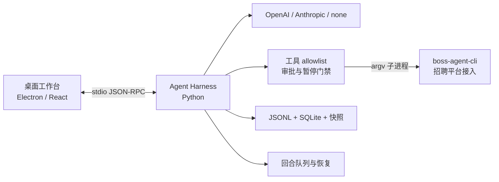

# BOSS Harness

<p align="center">
  <strong>面向招聘任务的 Agent Harness</strong><br>
  在桌面工作台里，把模型回合、招聘工具和可恢复会话连接成一条有边界的工作流。
</p>

<p align="center">
  <a href="https://github.com/can4hou6joeng4/boss-harness/actions/workflows/build.yml"></a>
  <a href="https://github.com/can4hou6joeng4/boss-harness/releases"></a>
  <a href="LICENSE"></a>
  <a href="https://github.com/can4hou6joeng4/boss-harness/issues"></a>
  <a href="https://github.com/can4hou6joeng4/boss-harness/pulls"></a>
  <a href="https://github.com/can4hou6joeng4/boss-harness/stargazers"></a>
</p>

<div align="center">

[English](#english-overview) · [快速开始](#快速开始) · [文档索引](docs/README.md) · [项目状态](docs/STATUS.md) · [版本变化](CHANGELOG.md)

</div>

> `boss-agent-cli` 负责招聘平台接入；BOSS Harness 负责模型适配、执行循环、权限边界、会话状态和桌面交互。内核参考 Pi 的 Agent Harness / Durable 设计思想，但按本项目的招聘安全契约独立实现。

**当前状态**：`main` 是开发分支，桌面从源码构建，尚无独立安装包或签名发行。已发布版本以 [Releases](https://github.com/can4hou6joeng4/boss-harness/releases) 为准，逐版本变化见 [CHANGELOG](CHANGELOG.md)，已具备、待验收与非目标范围见[项目状态](docs/STATUS.md)。

## 项目定位

BOSS Harness 不是把招聘平台包成一个聊天接口，而是把「模型想做什么」与「实际允许做什么」分开：

- **执行与扩展**：固定 14 项工具 allowlist（13 项只读，招聘者打招呼需逐次审批），能力发现不会增加权限；招聘动作只以 argv 子进程调用 `boss-agent-cli`。
- **平台动作**：写操作逐次审批，结果未知时先核对；不自动翻页、不批量沟通、不绕过平台风控。
- **会话与证据**：append-only JSONL + SQLite 索引，冻结快照、摘要、分支和导出都保留来源与边界。
- **资源与隐私**：上下文、附件、工具结果、技能和导出都有显式预算；模型与普通 renderer 不接收平台 Cookie。

**适合**：希望把模型接入招聘工作流，同时需要本地状态、可恢复会话和明确审批边界的开发者与小团队。

**不适合**：批量投递、批量打招呼、自动绕过验证码 / 风控，或把未发布源码候选当作生产安装包。

## 先找到你要的入口

| 你的目标 | 从这里开始 |
| --- | --- |
| 只安装已发布的 Python 内核 | [安装已发布的内核](#安装已发布的内核) |
| 从源码启动桌面并完成第一次只读查询 | [从源码启动桌面](#从源码启动桌面) → [试跑一条任务](#试跑一条任务) |
| 了解桌面交互与故障提示 | [桌面交互指南](docs/DESKTOP_GUIDE.md) → [使用指南](docs/USER_GUIDE.md) |
| 配置 OpenAI、Anthropic 或无模型模式 | [模型与运行时配置](#模型与运行时配置) → [使用指南](docs/USER_GUIDE.md) |
| 评估查询范围、权限和隐私边界 | [安全边界](#安全边界) → [内核与业务契约参考](docs/TECHNICAL_REFERENCE.md) |
| 接入自定义工具或参与贡献 | [模块与扩展](#模块与扩展) → [贡献与交付约定](CONTRIBUTING.md) |

## 能力地图

| 你想解决的问题 | BOSS Harness 的做法 |
| --- | --- |
| 让模型帮我找职位 | 将自然语言转换为结构化条件，只查询明确的逻辑页，并保留来源和分页事实。 |
| 让任务持续推进 | 用串行工具批次、`steering`、`follow-up` 和持久队列管理消息进入回合的时机。 |
| 避免招聘操作被重复执行 | 工具调用有稳定身份、逐次审批和结果未知边界；断连后先核对，不凭猜测重放。 |
| 让长会话可追溯、可恢复 | 原始记录写入 append-only JSONL，SQLite 提供可重建的索引；冻结快照、摘要和分支都保留来源切点，读取按响应预算分页。 |
| 控制上下文大小 | 每次模型请求前估算预算，可自动或手动摘要更早的回合；已结束消息可替换或排除，原始记录保留。 |
| 让每个回合带上项目约定 | 从工作区 `.boss-harness/CONTEXT.md`（兼容 `.boss-cli/CONTEXT.md`）读取有界、只读的常驻说明，每回合重新读取；内容作为上下文，不授予或扩大工具权限。 |
| 读取较大的附件与工具结果 | 超出响应预算的正文不整份返回，改按游标分段读回；引用绑定内容摘要，内容变化时拒绝混用版本。 |
| 核对用量与任务归属 | 用量面板按回合、摘要任务与合计展示 provider 上报；`task/read` 只读查询回合、队列或摘要任务的持久状态，不恢复也不重放任务。 |
| 在不同模型线路间切换 | OpenAI Responses、Anthropic Messages 和 `none` 共享同一套回合与工具契约。 |
| 在桌面里观察与管理 | Electron / React 工作台显示回合、工具、队列和上下文状态，并提供技能选择、会话归档删除与脱敏导出。 |

各项的数值上限、错误码与操作步骤见[使用指南](docs/USER_GUIDE.md)、[桌面交互指南](docs/DESKTOP_GUIDE.md)和[内核与业务契约参考](docs/TECHNICAL_REFERENCE.md)。

## 快速开始

有两种进入方式：已发布的 Python 内核 wheel 用于脚本化或嵌入调用；完整桌面工作台目前从源码启动，尚无独立安装包。两者都先准备 Python 3.10+（读取 Codex TOML 配置需要 3.11+，开发建议 3.12）和 `uv`。

### 安装已发布的内核

从 [GitHub Releases](https://github.com/can4hou6joeng4/boss-harness/releases) 下载最新的 `boss_harness-*.whl`，在独立虚拟环境中安装。wheel 只包含 Python 内核，不包含 Electron 桌面，也不包含招聘 CLI：

```sh
uv venv --python 3.12 .venv
uv pip install --python .venv/bin/python boss_harness-*.whl
.venv/bin/boss-harness --version
.venv/bin/boss-harness --help
```

把下载的 wheel 放在当前目录，或把命令中的文件名替换为实际路径。已发布资产及其校验和以对应 Release 说明为准；`--help` 列出该版本实际支持的参数，预发布之间可能变化。桌面与内核按同一源码版本配套使用，不要把旧预发布 wheel 与当前源码桌面混用。

### 从源码启动桌面

桌面需要 Node.js 24+ 与本仓库依赖。只验证桌面能否连接本地内核，不需要安装招聘 CLI 或登录；使用招聘工具前再按[上游 CLI 设置](docs/USER_GUIDE.md#上游-cli-设置)配置 `boss-agent-cli`。

```sh
uv venv --python 3.12 .venv
uv pip install --python .venv/bin/python -e ./harness
npm ci
npx install-electron --no
.venv/bin/boss-harness --check --provider none --format text
BOSS_HARNESS_PROVIDER=none npm run dev
```

`BOSS_HARNESS_PROVIDER=none` 只禁用模型，不禁用招聘 CLI。Electron 需要从源码启动；`npm run build` 只生成桌面源码产物，不是独立安装包。首次运行建议使用临时工作区与只读工具，不要在此阶段输入真实凭据。

首次自检与桌面启动都显式选择 `none`，不受当前 shell 的模型线路影响。自检不调用模型、不执行招聘 CLI；`MODEL_DISABLED` 是预期结果，其他检查仍会运行。配置模型后，可将自检的 `--provider none` 换成计划启用的线路再核对一次。也可以让编码 Agent 按 [SETUP.md](SETUP.md) 协助安装、自检与首次启动；凭据与平台登录仍由你本人完成。

## 试跑一条任务

桌面启动并完成上游 CLI 配置后，可以按下面的顺序从只读入口开始：

1. 确保 `boss-agent-cli` 已安装，并按[上游 CLI 设置](docs/USER_GUIDE.md#上游-cli-设置)确认本项目能找到其可执行文件。
2. 输入 `/tools`，查看上游当前提供的能力目录；它不是本地授权清单，实际可调用范围仍受 Harness allowlist 限制。
3. 输入 `/search Python`，确认上游 CLI 和工作区连接正常。
4. 要试用自然语言搜索，先按[模型配置来源](docs/USER_GUIDE.md#模型配置来源)配置 OpenAI 或 Anthropic，再用对应的 `BOSS_HARNESS_PROVIDER` 重新启动桌面。例如，配置 OpenAI 后运行 `BOSS_HARNESS_PROVIDER=openai npm run dev`，再输入 `上海 Python，20–50K，3–5 年，本科，先看第一页`。
5. 回合运行中发送新消息，选择转向当前回合，或将它排到当前回合结束后的队列。
6. 按 `⌘⇧K` 打开「运行状态」，核对内核线路、并发与保留回合、待审批调用、工具与模型目录。更多界面行为见[桌面交互指南](docs/DESKTOP_GUIDE.md)。

桌面新建的会话固定使用只读工具策略：`boss_hr_greet` 不在工具清单中，也不会出现写操作审批卡。逐次审批只出现在以审批策略创建的会话中，创建方式与桌面展示见[桌面会话的执行权限](docs/USER_GUIDE.md#桌面会话的执行权限)。

<details>
<summary>展开：这条搜索请求经过了什么</summary>

```text
自然语言条件
    ↓
模型生成结构化 boss_search 参数
    ↓
Harness 校验条件、页码和工具权限
    ↓
boss-agent-cli 查询指定逻辑页
    ↓
桌面展示结果、来源与分页事实
    ↓
用户决定是否查看下一页或继续追问
```

系统不会自动翻页、放宽条件或补取职位详情。下一页需要保留原条件并明确提交新的页码。
</details>

## 工作方式



| 组件 | 负责什么 | 交互结果 |
| --- | --- | --- |
| Electron / React 工作台 | 输入、消息、工具详情、队列、设置和上下文面板 | 用户能看到任务处于哪个回合、是否排队以及是否需要处理暂停。 |
| Python Agent Harness | 模型流、工具编排、审批、超时、持久化和恢复 | 一次回合的事实按顺序写入，可在重启后继续读取。 |
| `boss-agent-cli` | 招聘平台的登录、搜索、沟通列表和平台状态 | Harness 只派发已声明的业务契约，不替上游猜测分页或认证事实。 |
| JSONL + SQLite | 正文、事件、索引和快照 | 原始记录保留，索引可重建，冷读和恢复有明确预算。 |

完整交互清单见[桌面交互指南](docs/DESKTOP_GUIDE.md)，请求预算与恢复契约见[内核与业务契约参考](docs/TECHNICAL_REFERENCE.md)。

## 安全边界

- 读取职位或沟通列表不会自动回复、投递、导出简历或翻页；招聘者打招呼需要逐次审批，桌面新建的只读会话不包含该工具。
- 超时、断连或持久化异常可能使外部写操作处于结果未知状态；内核会暂停并要求先核对，不自动重放。
- 模型与普通 renderer 不接收平台 Cookie；业务 CLI 的认证、浏览器来源、缓存和网络重试仍由其自身契约决定。
- `none` 只表示不调用模型，不表示不调用招聘 CLI，也不代表不会访问平台。
- 代码交付授权不等于招聘平台操作授权；对外沟通、投递和批量操作需要用户明确授权。

不要把凭据、Cookie 或真实招聘记录放入仓库、Issue、PR 或公开日志。发现可能影响状态目录保护、JSON-RPC 边界、工具审批或导出脱敏的问题时，请按[安全政策](SECURITY.md)通过非公开渠道报告，不要在公开 Issue 中附带可利用细节。

## 模型与运行时配置

桌面默认使用 OpenAI Responses，通过 `BOSS_HARNESS_PROVIDER` 可选择 `openai`、`anthropic` 或 `none`，设为 `auto` 与不设置等价；空值或只有空白时按默认 `openai` 处理。

| 场景 | 配置入口 |
| --- | --- |
| OpenAI Responses | `BOSS_HARNESS_OPENAI_BASE_URL`、`BOSS_HARNESS_OPENAI_API_KEY`；模型由命令行 `--model`、`BOSS_HARNESS_MODEL`、`BOSS_HARNESS_OPENAI_MODEL` 或 Codex profile 提供。 |
| 本地 Codex profile | 显式 OpenAI 配置缺项时，依次读取 `BOSS_HARNESS_CODEX_CONFIG`、`CODEX_HOME/config.toml`、`~/.codex/config.toml`。 |
| Anthropic Messages | 使用 `ANTHROPIC_*` 环境变量；`BOSS_HARNESS_ANTHROPIC_MODEL` 可指定默认模型。 |
| 桌面使用的解释器 | `BOSS_HARNESS_PYTHON`；未设置时使用仓库根目录的 `.venv/bin/python`，不存在则用 `python3`。 |
| 招聘 CLI 可执行文件 | 按 `BOSS_CLI_BIN`、并排的 `boss-agent-cli/.venv/bin/boss`、PATH 顺序查找。 |
| 两类本地状态 | `BOSS_CLI_DATA_DIR` 管理上游登录 / 平台状态；`BOSS_HARNESS_DIR` 管理本项目会话。 |

运行 `.venv/bin/boss-harness --check` 可做本地配置预检（加 `--format text` 输出终端可读文本）。配置优先级见[模型配置来源](docs/USER_GUIDE.md#模型配置来源)，请求期限、重试、审批期限、转向模式与附件配额等参数见[其他运行参数](docs/USER_GUIDE.md#其他运行参数)，检查码与故障排查见[本地配置自检](docs/USER_GUIDE.md#本地配置自检)和[桌面启动失败时的自检](docs/USER_GUIDE.md#桌面启动失败时的自检)。不要把 API key 或其他凭据写入仓库、配置样例或日志。

## 模块与扩展

内嵌 Python 应用可以通过 `ToolDefinition`、`ToolBundle` 和 `ApplicationService` 组合工具，或注入生命周期 hook。自定义工具仍须显式声明 schema、handler 和审批属性；任何外部或持久副作用都必须进入审批边界。默认招聘 bundle、平台登录能力和工具说明不会因为能力发现自动扩展。

需要评估请求预算、恢复、摘要、冷读、回合所有权或 JSON-RPC 契约时，请直接阅读[内核与业务契约参考](docs/TECHNICAL_REFERENCE.md)。

## 开发与验证

```sh
uv venv --python 3.12 .venv
uv pip install --python .venv/bin/python -e ./harness build packaging
npm ci
npx install-electron --no
npm run check
npm run typecheck
npm run build
.venv/bin/python -m build ./harness --outdir dist/python
git diff --check
```

`npm run check` 依次运行全部构建前静态检查（`scripts/check_*.py`），覆盖版本与发布元数据、协议与传输、桌面与 IPC 安全、内核工具与审批、本地资源与隐私、连接、搜索、CI 工作流和文档链接；各脚本的核对范围见[构建前静态检查](docs/TECHNICAL_REFERENCE.md#构建前静态检查)。CI 先运行同一组检查，再执行依赖审计、TypeScript 检查、Electron 源码构建、Python wheel / sdist 构建与隔离安装，并在 Python 3.10–3.14 上分别核对搜索归一化与源码编译。

以上命令用于开发检查，允许使用工作树中的未提交改动；发布构建必须按[发布约定](RELEASING.md#构建与验收)从指定提交的 `git archive` 隔离目录执行。检查与构建通过不代表真实模型、招聘平台、桌面交互或签名安装包已验收；提交与 PR 流程见[贡献与交付约定](CONTRIBUTING.md)。

## 项目导航

| 文档 | 内容 |
| --- | --- |
| [文档索引](docs/README.md) | 使用、桌面与内核文档的职责和入口。 |
| [使用指南](docs/USER_GUIDE.md) | 模型配置、运行参数、自检、职位搜索、沟通列表、技能、队列和上游 CLI 设置。 |
| [桌面交互指南](docs/DESKTOP_GUIDE.md) | 搜索、审批、通知、会话查找、队列、长会话、界面偏好与导出行为。 |
| [内核与业务契约参考](docs/TECHNICAL_REFERENCE.md) | 请求边界、失败恢复、上下文预算、资源上限、模块接口与构建前静态检查。 |
| [项目状态与待验收范围](docs/STATUS.md) | 源码候选与实际发布的区别、已具备能力、待完成事项与非目标。 |
| [贡献与交付约定](CONTRIBUTING.md) | 开发约定、本地验证、提交格式、PR 与文档同步。 |
| [版本交付与项目介绍](RELEASING.md) | 版本节奏、版本一致性、发布验证与对外介绍。 |
| [版本变化](CHANGELOG.md) · [Releases](https://github.com/can4hou6joeng4/boss-harness/releases) | 每个源码候选的变化；已发布 tag、说明与可下载资产。 |
| [上游吸收记录](UPSTREAM.md) | Pi 等参考项目的来源、取舍和适配差异。 |
| [安全政策](SECURITY.md) · [支持与问题分流](SUPPORT.md) · [行为准则](CODE_OF_CONDUCT.md) | 安全报告渠道、提问入口与社区参与预期。 |

## English overview

BOSS Harness is an agent harness for recruiting tasks: a desktop workbench that connects model turns, recruiting tools, and recoverable sessions into one bounded workflow. Recruiting actions always run through the separately installed `boss-agent-cli` subprocess; this repository owns the execution loop, context, sessions, approvals, and the Electron shell.

- **Architecture**: Electron + React + TypeScript desktop shell, a Python ≥ 3.10 kernel, and a stdio JSON-RPC `0.2.0` process boundary. The shell does not import kernel code.
- **Execution**: streaming turns, steering / follow-up queues, per-action approvals and stop, append-only JSONL history with SQLite indexing, context budgets and compaction tasks, bounded read-only workspace instructions re-read every turn, durable restore, and branch-aware session state.
- **Safety boundary**: 14 allowlisted tools (13 read-only plus one greeting action that requires approval on every call); capability discovery never grants permissions, and neither the model nor the workbench renderer receives platform cookies.
- **Model routes**: OpenAI Responses (Codex or an explicit endpoint), Anthropic Messages, or `none`, sharing the same turn and tool contract. `none` disables the model only; recruiting CLI commands can still run.
- **Desktop**: the renderer reaches the main process only through a single `window.boss` preload bridge over host-validated IPC, under a local-only CSP. The workbench shows the persistent turn queue, workspace skills and auto-compaction settings; platform login runs in an isolated browser partition and session export is sanitized.
- **Design notes**: the kernel follows Pi's agent-harness / durable design ideas but implements this project's recruiting safety contract independently. A read-only review log of external reference repositories is kept in [UPSTREAM.md](UPSTREAM.md); those projects are not upstreams and their links do not imply endorsement.
- **Status**: `main` is the development branch and source candidates are not releases; use [GitHub Releases](https://github.com/can4hou6joeng4/boss-harness/releases) for published versions. The desktop is built from source and has no standalone installer yet. [Project status](docs/STATUS.md) lists implemented, pending and non-goal boundaries.

The commands under [快速开始](#快速开始) are language-neutral. Further documentation is in Chinese: [user guide](docs/USER_GUIDE.md) · [desktop guide](docs/DESKTOP_GUIDE.md) · [technical reference](docs/TECHNICAL_REFERENCE.md).

## License

本项目采用 [MIT License](LICENSE)；Python wheel / sdist 随附相同许可文本，第三方依赖遵循各自许可证。

欢迎通过 [Issues](https://github.com/can4hou6joeng4/boss-harness/issues) 反馈可复现的问题、使用场景或集成建议。向其他社区介绍本项目时，请遵守[发布约定中的对外介绍规则](RELEASING.md#对外介绍)，只写可验证的当前版本、来源与安装范围；参考项目的链接不代表其维护者背书。
